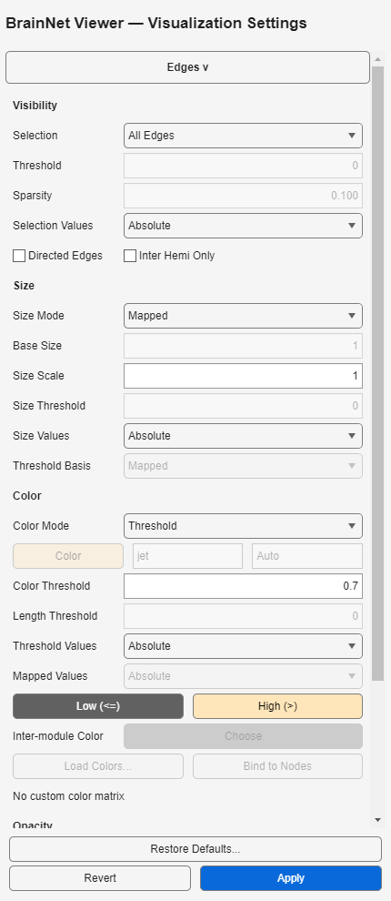
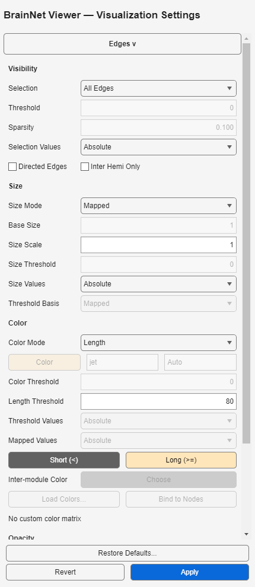

# 连边Threshold与Length双色配色

[English](Edge_Colors.en.md) · [迁移说明](Migration.zh-CN.md) · [色图](Colormaps.zh-CN.md)

## 固定双色与不同端点规则

| Color Mode | 低组颜色 | 高组颜色 | 取值来源 |
|---|---|---|---|
| Threshold | Low (<=)：数值小于或等于Color Threshold | High (>)：数值严格大于Color Threshold | 筛选后连边的原始权重，独立选择Signed或Absolute |
| Length | Short (<)：距离小于Length Threshold | Long (>=)：距离大于或等于Length Threshold | 两端原始节点XYZ坐标的欧氏距离 |

Threshold等号属于Low；Length等号属于Long。两种模式只使用指定的两个RGB颜色，不使用统一Color、Colormap或Color Limits来确定组颜色。Length Threshold为0时所有实际绘制的边均用Long。光照和透明度会改变截图中的视觉颜色；数值测试检查patch颜色数据，不把截图像素当作原始RGB。

**Threshold Values**独立于筛选的**Value Mode**。筛选决定保留哪些边，配色取这些边的原始带符号权重，而不是筛选过程中变换后的值。例如按绝对值>=2筛选，-3、2、3均保留；配色选Signed且Color Threshold=2时，-3与2为Low，3为High；配色改Absolute后，-3与3为High。节点半径、相机缩放、半球视图及方向箭头长度均不参与原始节点距离的定义。

Length使用节点文件的坐标单位；不是纤维束长度、测地距离，也不自动认定为毫米或白质测量。坐标配准及单位须单独确认。有向边的边体和箭头使用同一颜色。

## 桌面操作

1. 在Data Sources选择节点和连边文件，然后Validate and Load。
2. 展开**Visualization Settings → Edges >**，滚动至Color，选择Threshold或Length。
3. Threshold设置Threshold Values和Color Threshold；Length设置Length Threshold。不适用的色图、范围或阈值控件禁用。
4. 分别选择两组颜色。按钮根据模式显示Low (<=) / High (>)或Short (<) / Long (>=)，直接提示端点规则。
5. 点击底部唯一的**Apply**提交并渲染。**Revert**恢复已应用设置。Save Scene或Save Preset保存已应用的颜色与阈值，不保存未提交编辑。

## 旧EC及旧配置配置

完整窗体布局见[窗口布局说明](Window_Layout.zh-CN.md)；聚焦控件截图不认证所有显示会话或DPI设置。

旧EC.edg.color=3/4对应Threshold/Length。两者要求EC.edg.CM为至少64行的有限RGB矩阵：第1行为High/Long，第64行为Low/Short。缺失、过短或非法矩阵明确拒绝，不猜测颜色。导出恢复这两行及对应color_threshold/color_distance。Threshold的color_abs=0/1独立映射Signed/Absolute，不与draw_abs混用；color_abs缺失时使用旧默认Absolute。Length不用color_abs。导入报告继续保留其他未映射字段待复核。

Settings **1.6.0**增加edge.color_low、edge.color_high、edge.threshold_value_mode；后者只作用于Threshold，不作用于Mapped、大小或透明度。Scene v0.1和preset v1.0外层版本不变。当前版本文档缺少必需字段时拒绝读取。

旧Settings 1.0–1.5迁移时，以原统一颜色作为Low、原色图末端作为High，Threshold Values默认Absolute。这是确定性迁移，**不能恢复原EC，也不保留之前的连续配色外观**。Threshold等号与Length外观可能变化，请复核双色或重新导入未修改的原EC。Scene元数据记录edge_color_upgrade；只有旧规范化输入/设置签名匹配才重绑相机，过期视角不重绑；预设不携带相机。旧软件不保证读取Settings 1.6。

## Mapped配色更新

在 **Edges > Color** 选择Mapped，通过 **Mapped Values** 独立选择Signed或Absolute，再计算配色范围；不改变连边选择、半径、透明度或Threshold Values。范围框留空为Auto（已选权重范围），填写`low high`为Fixed。仍使用唯一的全局 **Apply/Revert**。

Mapped采用64级颜色和旧版索引公式`round(weight*k+b)`，其中`k=63/(high-low)`、`b=64-k*high`，索引截限到1–64。上下限相同（含Auto常量权重）时取第64色。例如固定范围[-2,2]，权重[-3,-2,0,2,3]对应索引[1,1,33,64,64]。命名色图和现代自定义色表均采样到64色，区别于先前256级及常量取第一色的行为。拒绝非有限/复数权重、倒置范围和数值溢出。

旧EC Mapped（`edg.color=2`）导入`color_abs`、`color_map_type`（1 Auto / 2 Fixed）、固定上下限及实际CM前64行。CM缺失/无效或Fixed缺少上下限时拒绝；长色表仅用前64行，与旧连边索引一致。缺少符号/范围类型时默认Absolute/Auto。导出写入64行CM及对应的有效符号/范围；Auto的不活动上下限规范化为0/1，不执行色图表达式字符串。

Settings **1.8.0** 新增`edge.mapped_value_mode`。新建默认Absolute，旧1.0–1.7配置缺少此字段时迁移为Signed，以保留原来的符号处理，**不保证原颜色完全不变**。此前忽略的原EC符号、色表和固定范围不能恢复，有原EC时建议重新导入。Scene记录`edge_mapped_color_upgrade`，仅有效旧相机签名会重绑；迁移后应复核配色。Scene/预设外层版本不变。

## 仍待处理的边界

### 模块配色更新

选择 **Node Module**，设置 **Inter-module Color**。比较连边两个端点：同模块使用**Nodes**模块色表，跨模块使用独立RGB。按**全部已载入节点**（包括孤立/隐藏节点）的模块编号排序确定色表行；筛选连边或改变方向不重新编号。编号21按普通模块处理，不再充当跨模块标记。专项验证起，同模块边继承Nodes colormap；若可见节点需同色，请选择Nodes → Modules。Edges自己的colormap字段不覆盖此模式。

本版最多支持**20个不同模块**，超出时明确报错，不循环复用颜色；命名/自定义色图均采样为20行。旧EC color=5导入CM前20行及跨模块第21行，导出对应21行。CM缺失/过短/非法时拒绝。旧EC渲染等价要求模块不超过20且原标签没有21；旧渲染器的标记冲突无法由EC本身消除，App中此模式要求Modern Batch Renderer。

Settings **1.10.0**新增`edge.inter_module_color`，旧配置默认灰色[0.5,0.5,0.5]并提示复核，不保留原错误的“只看起点”外观。Scene记录迁移提示，仅重绑有效旧相机签名；恢复原配色需重新导入原EC。继续共用全局Apply/Revert。

这些改动不改变Uniform、Threshold和Length规则。现支持[Raw/Threshold大小及独立粗细符号](Edge_Sizes.zh-CN.md)。现支持[透明度独立符号](Edge_Opacity.zh-CN.md)。现支持[Custom矩阵配色与节点绑定](Custom_Edge_Colors.zh-CN.md)。现支持[Inter Hemi Only](Edge_Hemisphere.zh-CN.md)；现支持[稀疏度/并列规则](Edge_Sparsity.zh-CN.md)。不能据此关闭整个旧版兼容性问题。详见[已知限制](Migration.zh-CN.md#known-limitations)。
