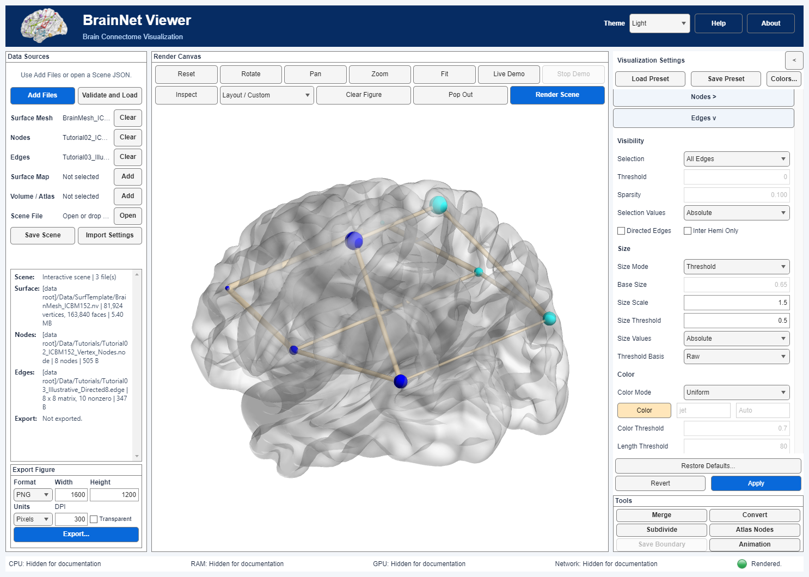

# Edge radii: Uniform, Mapped, Raw and Threshold

[中文](Edge_Sizes.zh-CN.md) · [Edge colors](Edge_Colors.en.md) · [Migration](Migration.en.md)

Sizes are **radii in input coordinate units**, not pixel line widths or diameters. The selected edge list supplies original weights. **Selection Values**, **Size Values** and color **Threshold Values** are separate controls; changing the size sign does not select additional edges or redefine their colors.

## Order of operations

Apply Size Values (Signed or Absolute) to original retained weights first. All weights in the table below mean these sign-adjusted, not-yet-normalized values. Then:

| Size Mode | Radius before Size Scale |
|---|---|
| Uniform | Base Size. Size Values is inactive. |
| Mapped | Linearly map all retained weights to 0.4–6; equal weights use 2. |
| Raw | Clamp weights to 0.2–6. This is not an unlimited raw-radius mode. |
| Threshold + Mapped | Test weights with `>= Size Threshold` before normalization; map only that qualifying subset to 0.4–6 (constant subset: 2). Below threshold: 0.4. |
| Threshold + Raw | Below threshold: 0.4; qualifying weights remain raw, with an upper cap of 6. There is no 0.2 lower floor in this branch. |

Finally multiply every radius, including Uniform and below-threshold radii, by **Size Scale exactly once**. Threshold does not remove edges; Visibility controls selection. An empty qualifying subset produces only the 0.4 base radius, and an empty selected edge list stays empty. These edge rules differ from node-size normalization.

Example: Signed weights `[1, 2, 3]`, Threshold 2, Mapped basis, Scale 2 produce radii `[0.8, 0.8, 12]`. Weight 2 qualifies and becomes the minimum of the qualifying subset. A singleton qualifying subset instead has pre-scale radius 2.

Raw Threshold may produce zero; zero-radius tubes and arrowheads are omitted from geometry without changing edge-selection/Connected semantics. Negative final radii or numerical overflow raise an English error; the software does not silently convert them to absolute radii. Increase the threshold or choose Absolute when scientifically appropriate.

## Desktop workflow

1. Load nodes and edges, then expand **Edges >** on the right.
2. Under Size, select Uniform, Mapped, Raw or Threshold.
3. Set Size Scale. Uniform enables Base Size; non-uniform modes enable Size Values. Threshold additionally enables Size Threshold and Threshold Basis.
4. Use the one global **Apply** to commit and render. **Revert** restores applied settings. Pending edits are not saved by Save Scene/Save Preset.
5. Save Scene for inputs and view state; Save Preset for settings only. Export Figure remains under Data Sources.

The existing directed-arrow shape rules are unchanged; tubes and arrowheads both consume the updated radius. Changing the size mode, sign, threshold basis or scale changes the geometry-cache key.

## EC and older development files

Legacy `EC.edg.size=1/2/3` means Uniform/weighted/Threshold. `size_value=1/2` means Mapped/Raw; weighted + Raw imports as modern Raw. `size_abs=0/1` maps independently to Signed/Absolute, not draw_abs or color_abs. size_size, size_ratio and size_threshold retain their respective values. Missing size_value/size_abs use legacy defaults Mapped/Absolute; present invalid codes are rejected. Export writes these fields back (inactive Uniform size_value is canonicalized).

Settings **1.7.0** adds `edge.size_threshold_basis` and `edge.size_value_mode`, plus Raw as a size mode. Scene v0.1 and preset v1.0 envelopes are unchanged. Current settings missing required fields are rejected.

Settings 1.0–1.6 upgrade to Mapped threshold basis and Absolute size values. **This does not recover previously ignored EC Raw/Signed intent or preserve the old incorrect Threshold appearance.** Uniform now applies Scale; Threshold uses the original-weight/subset rule instead of a two-constant-radius rule. Review old files or reimport the untouched original EC. Scene metadata records edge_size_upgrade; a stored camera is rebound only if its old input/settings signature was valid. Stale camera bindings remain stale. Presets carry no camera.

## Scope

After changing radii or migrating an old Scene, use **Fit** explicitly if larger geometry extends beyond the retained view. A valid saved camera is preserved, not silently refitted.

Related guides cover [mapped-color signs/ranges](Edge_Colors.en.md), [independent opacity signs](Edge_Opacity.en.md), [custom edge index matrices](Custom_Edge_Colors.en.md), [Inter Hemi Only](Edge_Hemisphere.en.md) and [sparsity/tie semantics](Edge_Sparsity.en.md). These controls do not alter edge selection. Review their individual rules when importing legacy settings.
