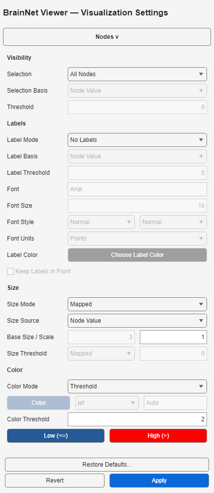

# 节点配色：第4列与阈值双色

[English](Node_Colors.en.md)

## 科学含义

.node第1–3列为坐标，第4列为颜色值/模块，第5列为大小，第6列为标签。**Mapped、Threshold、Modules和Custom节点配色使用第4列；仅改变第5列不能改变颜色。** 大小语义不在本轮修复范围。

- Uniform使用单一Color按钮。
- Mapped将第4列映射到256行RGB采样色图。空范围取完整输入第4列最小/最大值，不是仅取可见节点；固定范围之外截断到端点。自动范围下所有数值相同时取首色。这是现代量化映射，不承诺与旧色表索引/像素逐点相同。
- Threshold严格双色：第4列 **小于或等于** Color Threshold用 **Low (<=)**；**大于** 阈值用 **High (>)**。色图和范围不影响这个模式。
- Modules沿用排序后的唯一模块值映射规则，自定义模块色表行为保留。

## 界面操作

1. 载入节点数据，展开Visualization Settings的 **Nodes >**。
2. 选择 **Color Mode**。Mapped设置色图和可选范围；Threshold设置 **Color Threshold**、**Low (<=)** 和 **High (>)**。
3. 用底部唯一 **Apply** 提交并渲染。双色修改在Apply前只暂存；**Revert**恢复上次提交的值。
4. Save Scene或Save Preset均保存双色；Scene另含输入引用及有效会话状态。

## 旧EC设置

`EC.nod.color=4`的导入要求 `EC.nod.CM` 为至少64行的有限RGB表：**第1行为高值色，第64行为低值色**。缺失或行数不足明确拒绝，不猜测配色；阈值来自 `EC.nod.color_threshold`。Mapped（2）模式保留可用的数值CM，不执行MATLAB表达式。Uniform取CM首行。

`color_map_type=1`表示自动范围，即使残留low/high也不采用；2表示固定范围且必须提供两端。若类型字段缺失，则两端齐全时沿用此前导入约定。导出EC将阈值双色写回第1/64行，并写入范围类型。本轮不认证其他旧字段，仍须检查导入报告。

## 旧配置Scene与预设

Settings 1.0–1.2升级到1.3。缺少新增颜色时，Low取原保存的统一节点色，High取原保存色图的末色。这是明确的迁移约定，不是恢复旧双色意图：此前现代Threshold高组是连续色，且取错数据列。**升级后须重新检查旧Mapped/Threshold图像，颜色变化是本次纠正的预期结果。**

旧Scene元数据记录配色升级提示；仅在核对旧规范化设置/输入签名有效后迁移相机绑定，过期相机不重新绑定。Preset只升级设置，不导入相机。双色字段始于Settings 1.3，并保留在当前1.5文件中，不保证旧构建可读取。
