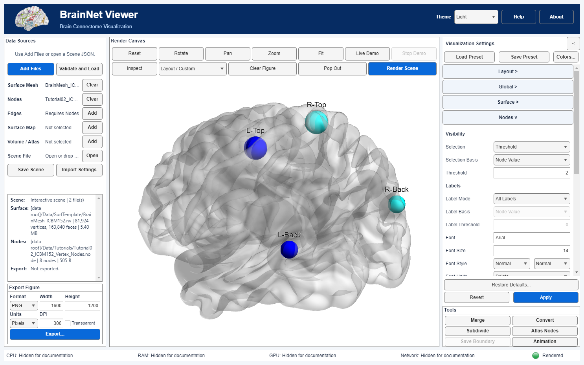

# Node selection, labels and Connected

[中文](Node_Selection.zh-CN.md) · [Node sizes](Node_Sizes.en.md) · [Node colors](Node_Colors.en.md)

## Display rules

| Control | Rule |
|---|---|
| Selection: All Nodes | All input nodes, subject to valid, nonzero rendered radius |
| Selection: Threshold | Original basis value strictly **> Threshold**; equality is excluded |
| Selection: Connected Nodes | Either endpoint of an edge retained by the current edge filters |
| Label Mode: All Labels | Labels on visible, nonzero-radius nodes, except the single-dash marker |
| Label Mode: No Labels | No node labels |
| Label Mode: Threshold | Visible node's original label-basis value strictly **> Label Threshold**, except the single-dash marker |

For both thresholds, **Node Value** means original .node column 5; **Module** means column 4. Selection Basis and Label Basis are independent. These comparisons do not use mapped radii, Scale, node colors or computed network degree. The word Module does not imply equality to a module ID: it is a numeric `>` comparison.

A label exactly equal to `-` means no label. It does not hide the node. Names such as `C-D` are retained. Label text is literal, not interpreted as TeX. Label selection is an additional filter on visible nodes; it never brings hidden nodes back. Zero-radius nodes remain governed by the [size rules](Node_Sizes.en.md).

## What Connected means

Connected node selection uses the endpoints of the displayed, filtered edges rather than the raw matrix.

- Undirected mode uses nonzero upper-triangle entries; directed mode uses nonzero off-diagonal entries. A node may be either source or target. The raw matrix is not automatically symmetrized.
- Diagonal entries do not make a node connected. No selected edges means no Connected nodes.
- Edge Threshold retains values **>=** its threshold, after Signed/Absolute selection. This edge inequality is intentionally different from node/label **>**. Negative values can remain in All mode or when the configured threshold permits them.
- Modern Sparsity uses its existing retained edge set. Its denominator and tie policy are not certified as a legacy equivalent here.
- Connectivity is evaluated globally before splitting hemispheres/views. A cross-hemisphere edge can make both nodes Connected even when that particular edge is not drawn in a hemisphere-only view.

Connected is a display rule, not a claim that the raw network has zero degree for a hidden node. Changing edge filters can change Connected nodes and their labels. Node filtering does not itself delete input edges. Legacy Inter Hemi Edges remains an open compatibility item; do not infer support for it from this review.

## Desktop workflow

1. Load nodes and, for Connected, edge data. Open **Visualization Settings → Nodes >**.
2. Under Visibility, choose Selection. Threshold enables its basis and value; Connected uses the edge settings and disables the inactive node-threshold controls.
3. Under Labels, choose Label Mode. Threshold enables independent Label Basis and Label Threshold.
4. Use the single bottom **Apply** to commit and render. **Revert** restores the last applied settings. Save Scene or Save Preset stores the applied values.

## Migration and EC

EC mappings are retained: nod.draw=1/2/3 means All/Threshold/Connected; nod.draw_threshold_type=1/2 means column 5/4. lbl=1/2/3 means All/None/Threshold; lbl_threshold_type=1/2 means column 5/4. nod.draw_threshold and lbl_threshold are independent thresholds. Round-trip tests cover both bases; the input EC is not changed.

Settings 1.0–1.4 upgrade to **1.5**, a semantic version marker with no new control fields. Equality cases may lose a node or label, and single-dash labels disappear; review old development figures. Existing thresholds and bases are preserved, not adjusted to approximate the earlier incorrect `>=` result. Connected behavior is unchanged.

Old Scene metadata records node_selection_upgrade. Only a matching original canonical input/settings signature allows saved camera rebinding; stale cameras stay stale. Presets upgrade settings without cameras. Scene v0.1 and preset v1.0 envelopes are unchanged; previous builds need not accept Settings 1.5. Earlier color/size migration requirements still apply.

See [remaining compatibility limitations](Migration.en.md#known-limitations). Edge color/size/opacity semantics and label layout remain separate tasks.
