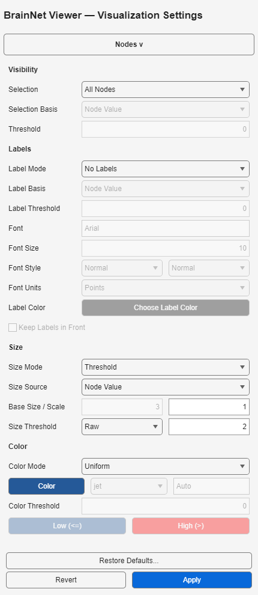

# 节点大小：Raw、Mapped与阈值半径

[English](Node_Sizes.en.md) · [节点配色](Node_Colors.zh-CN.md)

## 科学含义与计算顺序

**Size Source → 大小处理 → Scale → 半径**。半径与节点坐标使用同一单位；软件不自动推断毫米，也不是按球体体积编码。半径翻倍，球体体积会增加到8倍。

Size Source的 **Node Value** 使用.node第5列；**Module** 使用第4列，是现代扩展，不是旧版Raw选项。非统一模式的模块来源大小无法导出为旧EC，必须使用现代渲染器。配色独立设置。

| Size Mode | 乘Scale前的半径 |
|---|---|
| Uniform | Base Size |
| Mapped | 按旧算法处理完整输入：平移负值、抬高最小值、当最大/最小比超过10时反复取对数压缩，最后线性映射到2–7；常量输入为4 |
| Raw | 原始来源数值，不做归一化 |
| Threshold / Mapped | 先归一化，再把严格小于Size Threshold的半径改为1 |
| Threshold / Raw | 先取原始来源数值，再把严格小于Size Threshold的半径改为1 |

**所有模式最终都只乘一次Scale**，包括Uniform。等于阈值时保留，阈值比较发生在Scale之前；Threshold不是两种固定大小。例如Raw `[1,2,3]`、阈值2、Scale=3，半径为`[3,6,9]`；Mapped `[1,2,3]`、阈值4.5、Scale=2，半径为`[2,9,14]`。

归一化使用完整输入，在可见性筛选和半球拆分之前计算。负半径或溢出明确拒绝，不自动取绝对值；最终半径为0时不画该节点球体及标签，但保留输入节点与连边。Raw阈值模式中的负值若被阈值规则替换为1，可得到有效半径；不复刻旧版负半径的退化绘图。

## 界面操作

1. 读取节点，展开 **Visualization Settings → Nodes >**，滚动到 **Size**。
2. 选择 **Size Mode** 和 **Size Source**。Uniform启用Base Size；所有模式均可调整Scale。
3. Threshold模式在Size Threshold旁选择 **Mapped** 或 **Raw**，并输入阈值。其他模式禁用这两个阈值控件；Base Size不影响Threshold。
4. 用底部唯一 **Apply** 提交并渲染。**Revert**放弃未提交编辑；Scene/预设保存已应用设置。

## 旧EC与旧配置文件

| EC字段 | 现代设置 |
|---|---|
| nod.size=1 | Uniform |
| nod.size=2、size_value=1 | Mapped，Node Value |
| nod.size=2、size_value=2 | Raw，Node Value |
| nod.size=3、size_value=1 | Threshold / Mapped，Node Value |
| nod.size=3、size_value=2 | Threshold / Raw，Node Value |
| nod.size_size / size_ratio / size_threshold | Base Size / Scale / Size Threshold |

本轮依据冻结旧渲染器的计算顺序，不沿用旧对话框滑块的取值范围。Uniform忽略不生效的size_value选项；EC缺少size_value时沿用默认Mapped解释，非法枚举编码拒绝。原始.node文件不改写。

Settings 1.0–1.3升级到1.4，缺少size_threshold_basis时补Mapped。**旧Uniform在Scale不为1时，以及旧Threshold设置，纠正后可能呈现不同大小，必须复核图像。** 已保存的模块来源大小仍保留为Module；无法区分旧EC误导入与用户有意设置，需重新导入未改动的原EC才能恢复Raw意图，不能一律自动转换。

旧Scene元数据附node_size_upgrade；核对旧规范化输入/设置签名后才迁移有效相机，过期相机不重绑。预设只带设置，不带相机；Scene v0.1和预设v1.0外层版本不变，不保证旧构建读取Settings 1.4。
