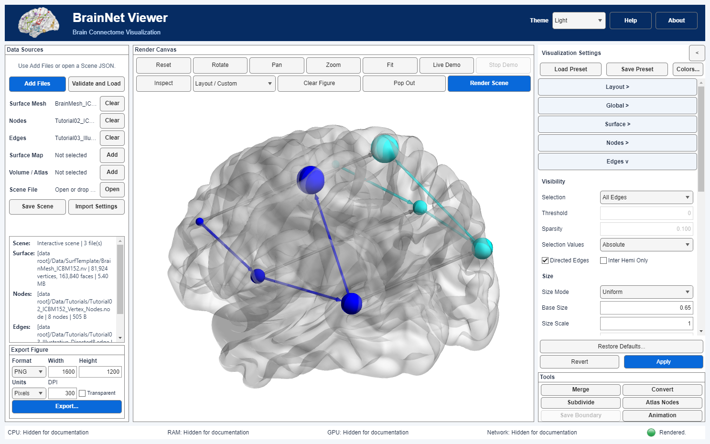

# Scene files, legacy settings, and command-line rendering

The current version supports [Clear Figure](Clear_Figure.en.md): release rendered views without removing inputs or applied settings; the main camera can be replayed by Render Scene.

development build: optional, input-bound [coordinate and atlas inspection](Scene_Inspection.en.md) is preserved by Save Scene; it is not a visualization preset or an inferred registration.

MOVIE.BYU `.g` triangle surfaces now use the shared App/Scene/CLI route; see [BYU geometry and multipart boundaries](BYU_Surfaces.en.md).

Development guide · BrainNet Viewer 2.0 · development build · 2026-09-06

## Desktop workflow

1. Start `BrainNetViewer` from the project root containing the top-level launcher (or add that root to the MATLAB path). See [Getting started](Getting_Started.en.md).
2. Select inputs in **Data Sources**, use **Validate and Load**, then configure **Visualization Settings**. The shared **Apply** commits pending edits and renders the Scene; use **Render Scene** for an explicit redraw.
3. Inspect the result, then interact or export as needed.
4. Select **Save Scene**, below the individual file slots, to save a UTF-8 Scene JSON. Saving does not discard the rendered canvas.
5. Use **Open Scene JSON** in Data Sources to restore the saved inputs and applied visualization settings, then validate/load and render again.



The Scene contains file references, input SHA-256 hashes, coordinate-space and redistribution metadata, and applied Visualization Settings. **Save Scene now also records the modern main renderer's camera state and the export panel preferences**, using optional `metadata.session_state` version 1.0. It does not embed data, transfer permissions, or capture unapplied editor changes. Existing Scene files without session state remain supported.

### Camera controls and replay

- **Reset** restores the initial directions, centers, distances, and scale of the configured layout, not an identical 3-D direction in every pane.
- **Fit** retains each pane's direction, recenters its scientific geometry, and uses a shared orthographic camera distance and scale with an 8% margin. It does not move or overlap axes regions; labels and colorbars do not determine the fit bounds.
- In multi-view layouts, rotating/panning a pane can change its own direction/center; camera distance and view angle remain linked across panes. Zoom is shared. Intentional zoom can crop content within a pane; Fit restores complete framing. Single-view standard directions are disabled in multi-view layouts to preserve their meaning.
- Save before closing to retain the current modern renderer's camera state. Changing input/configuration content invalidates the saved camera binding and uses the new layout defaults; export preferences remain usable. The binding is a deterministic Scene-content signature, not an authenticity/security signature.
- **Pop Out** starts from the main renderer's current camera state. It remains an independent inspection copy; its subsequent mouse changes do not replace the main renderer's saved/exported state.
- A saved camera preserves world-space orientation/center/distance/view angle, not a window's pixel geometry. Changing window aspect ratio may change framing; use Fit when necessary. Manual camera changes are not automatically saved to disk.
- Camera persistence applies to the modern renderer, not the legacy GUIDE fallback. Export provenance records the camera at export time.

### Resizing the desktop

The supported minimum window size is 960×680. The canvas toolbar wraps into one, two or three rows based on the available canvas width, including when the settings column is collapsed. **Render Scene** and **Pop Out** remain directly accessible without horizontal scrolling. The single **Revert / Apply** footer remains below the scrollable settings categories; resizing does not discard pending edits.

Axes keep their normalized layout regions during window-size changes. Resizing does **not** silently invoke Fit or Reset: it preserves camera orientation, target, distance and zoom, including deliberate off-center views. A different canvas aspect ratio can change the visible field; use **Fit** explicitly if you want to recenter and fully frame the geometry. These are framing controls, not scientific-coordinate transformations.

## Data-root rule

Input paths are relative to **DataRoot**, not to the JSON file's folder or the current MATLAB folder. The desktop uses the root supplied at launch; the default root is `src/matlab/BrainNetViewer` in this project. Move the data with the same relative directory structure, then explicitly select the corresponding DataRoot. A Scene file alone is not a portable data package.

If you choose a file outside the App data root, the App asks before staging a verified copy in `user-data/imports/<hash>/`; the original is unchanged. Programmatic `selectInputPath` requires explicit `ExternalImportApproved=true` for that action. Staging supported companion files does not grant redistribution rights. Saving verifies existing input hashes and fills missing ones. Missing files or changed hashes stop the save; the original Scene JSON is retained. Programmatic saves and exports refuse overwrites unless `Overwrite=true`. The desktop save dialog provides the overwrite confirmation.

## Import trusted legacy MAT settings

Select **Import Settings** and a trusted `.mat` file containing `EC`.

- With a current Scene: import settings only; preserve its input files and map mode. Any `File`/`FLAG` variables in the MAT file are ignored and reported.
- Without a current Scene: require scalar `EC`, `File`, and `FLAG` structures. Resolve relative `File.MF/NI/NT/VF` paths against the data root. Inputs outside that root require explicit reselection; they are not copied automatically.
- This is a conversion, not execution of GUIDE or a restoration of every legacy behavior. Missing settings take the modern mapper's defaults rather than retaining the current Scene's settings.
- Review the imported appearance before saving. `metadata.legacy_config_import` records the MAT hash, mapped fields, warnings, all input leaf fields, and `fields_requiring_review`. The review list conservatively includes conversions that the existing mapper does not individually certify, not only unsupported fields. `lossless_claimed` is always false.

MAT files are trusted-input only: MATLAB loading is not a sandbox for untrusted serialized objects. Only the relevant top-level variables are loaded; arbitrary colormap expressions are not executed by this workflow.

## Command line without the desktop App

From the project directory:

```matlab
record = BrainNetRender("my-scene.json", "figure.png", ...
    DataRoot="D:/my-data", ComputeBackend="cpu", ...
    Width=2000, Height=1500, Resolution=300);
```

This reads the Scene, validates data, prepares the modern numeric scene, renders a hidden figure, and exports the image plus `figure.png.provenance.json`. It does not open the BrainNet desktop App or call the legacy `BrainNet_MapCfg`. MATLAB graphics and a valid license are still required; this is not yet a display-server-independent Docker renderer. The old `BrainNet_MapCfg` calling signature is unchanged and is **not** replaced by this entry point.

Supported output extensions: `.png`, `.jpg/.jpeg`, `.tif/.tiff`, `.bmp`, `.pdf`, `.svg`. PDF/SVG may use embedded raster content for complex scenes, as recorded in the sidecar. Raster formats do not support `ContentType="vector"`.

Optional arguments:

| Argument | Meaning |
|---|---|
| `ComputeBackend` | `auto`, `cpu`, or `gpu`; existing per-operation GPU availability/fallback rules apply. |
| `PerformanceMode` | `quality` (default), `interactive`, or `auto`. |
| `Width`, `Height` | Supply both or neither; omitted dimensions use saved export preferences, falling back to Scene `image.width/height` in pixels. |
| `Resolution` | DPI; omitted value uses saved export DPI, otherwise `image.dpi`. |
| `Units` | Saved units with saved dimensions; explicit dimensions without Units use pixels. Explicit units may be pixels, millimeters, centimeters, inches, or points. |
| `BackgroundColor` | Omitted value uses the saved preference, otherwise `current`; explicit values override it. JPEG/BMP do not support `none`. |
| `ContentType` | Uses the saved preference when the output extension matches the saved format; otherwise auto. Explicit values take precedence and remain subject to format constraints. |
| `LegacyConfig` | Trusted EC MAT file applied before rendering; this replaces settings using mapper defaults. |
| `Overwrite` | `false` by default; protects both image and sidecar. |
| `Planner` | Reusable `brainnet.render.RenderPlanner` for preparation-cache reuse within a MATLAB process. |

For publication-quality repeatability, request `PerformanceMode="quality"` and `ComputeBackend="cpu"` explicitly. Pixel-identical graphics across MATLAB versions, graphics drivers, or operating systems are not guaranteed. Validation compares numeric fingerprints, cache identities, settings, and scene structure, not image-file hashes.

```matlab
scene = brainnet.io.readScene("my-scene.json");
[converted, report] = brainnet.io.importLegacyConfig( ...
    "old-settings.mat", "D:/my-data", Scene=scene);
brainnet.io.writeScene(converted, "converted.json", "D:/my-data");
```

The JSON provenance can contain local input/configuration paths and metadata. Review it, resource permissions, and any sensitive identifiers before publishing. No files are uploaded automatically.

To reuse only the display configuration on different datasets, use the right-hand **Save Preset / Load Preset** controls instead of opening a Scene. See [Visualization presets](Visualization_Presets.en.md) for compatibility review, input/camera isolation and API examples.

Use **Tools → Merge Surfaces...** to join meshes without replacing the current Scene. See [Surface merging](Surface_Merging.en.md) for the mandatory space/unit review and non-overwriting output.

After rendering Automatic surface boundaries, **Tools → Save Surface Boundary...** exports an original-order binary vertex mask. See [Surface boundaries](Surface_Boundaries.en.md), including the explicit numerical differences from legacy boundaries.

FreeSurfer `.pial` inputs are supported by the shared App/Scene/CLI reader. See [FreeSurfer surfaces](FreeSurfer_Surfaces.en.md) for encoding and coordinate-registration boundaries.

BrainVISA `.mesh` inputs use the independent single-frame triangle reader. See [BrainVISA surfaces](BrainVISA_Surfaces.en.md), especially the explicit difference from legacy XYZ inversion.

MNI/BIC `.obj` inputs use the independent single-object triangle reader (ASCII and binary). See [MNI/BIC surfaces](MNI_BIC_Surfaces.en.md) for byte-order, appearance and registration boundaries; Wavefront OBJ is not supported.

MZ3 `.mz3` / `.mz3.gz` surface geometry is supported in raw/GZip form. See [MZ3 surfaces](MZ3_Surfaces.en.md): embedded RGBA/scalars are validated, not automatically applied as visualization settings or maps; overlay-only MZ3 is not routed to Surface Map.
