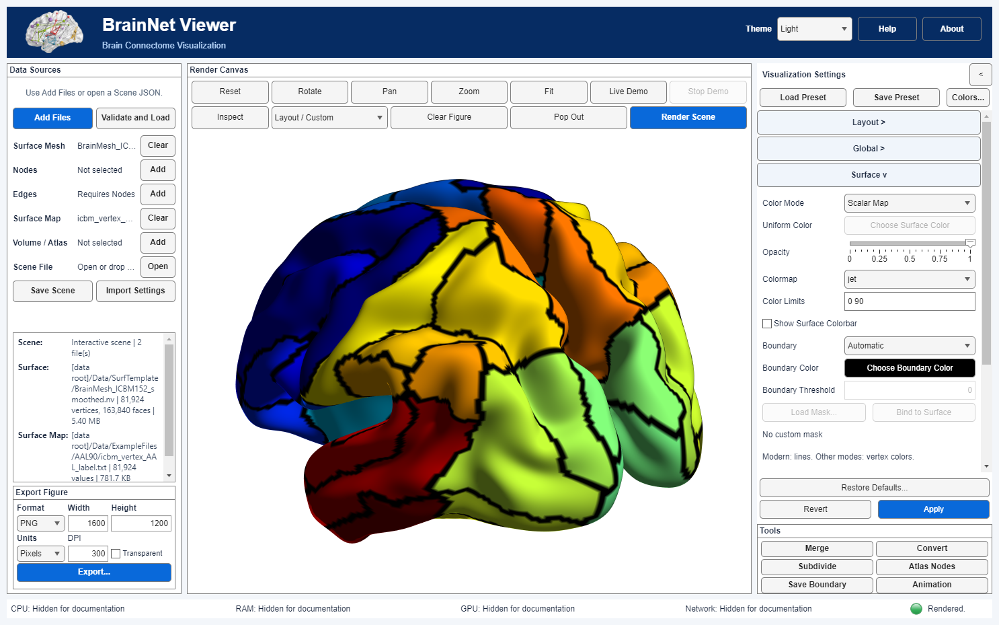
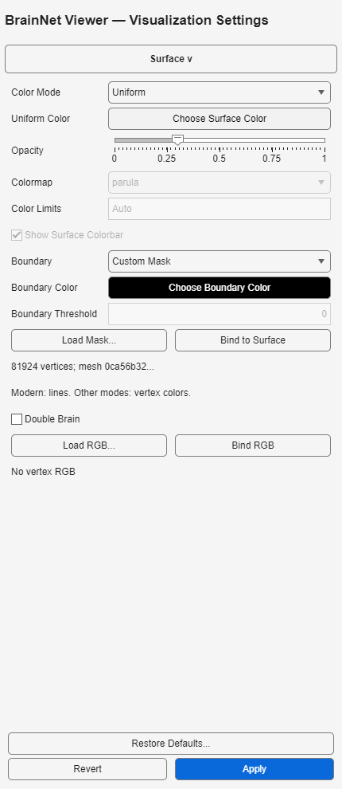

# 曲面边界与二进制掩码

## 操作流程

1. 读取 **Surface Mesh**；自动/阈值模式还需读取 **Surface Map** 或映射到曲面的体数据。
2. 打开 **Surface → Boundary**，选择模式并填写参数，再用统一的 **Apply** 提交并渲染。当前面板提供None、Automatic、Threshold和Custom Mask；旧Legacy Automatic仅为兼容设置，不作为独立现行菜单选项。
3. 渲染后选择 **Tools → Save Surface Boundary...**，保存到新的 `.txt`；已有文件禁止覆盖。

使用 **Custom Mask** 时，点击 **Load Mask...**，选择二进制文本并明确确认它对应当前曲面的原始顶点顺序。旧 EC 导入的掩码可通过 **Bind to Surface** 确认绑定。读取/绑定只是暂存，统一 **Revert** 撤销、**Apply** 提交；取消不改变设置。



## 四种模式

| 模式 | 分类和顶点选择 | 显示 |
|---|---|---|
| Modern Automatic | 所有有限值距整数小于 `1e-8` 且原值不超过256种时使用整数标签，否则用正/零/负类别；选取类别不同边的两个有限端点，包括零值端点 | 交界线 |
| Legacy Automatic | 精确保留旧有限值判断：若 `sum(T-fix(T)) ~= 0`，所有非零值合为1，否则保留原类别；选择混合类别三角形的顶点，再排除原 T 为零的顶点 | 顶点着色 |
| Threshold | 以 `T > threshold`（严格大于）分类，选择混合三角形顶点，再排除原 T 为零的顶点 | 顶点着色 |
| Custom Mask | 直接使用原始顺序的0/1掩码；不需要映射数据 | 顶点着色 |

Legacy Automatic 有意保留“正负小数部分抵消”的旧行为：小数之和为零时不会合并类别；也没有256类上限。这是兼容模式，**不是**改进的连续等值线算法。Threshold 同样不是插值等值线。旧自动/阈值模式拒绝 NaN/Inf，现代自动忽略涉及这些值的边；自定义选择不取决于映射值。

分类及掩码始终依据完整原始几何，各视图共享相同的顶点选择。顶点着色保留所选 shading，数值掩码一致不代表旧光照/光栅图像逐像素一致。自定义掩码模式强制使用完整曲面，避免简化网格破坏顶点编号；节点/连边加速仍保留。



## 掩码安全与复用

文本只接受空白分隔的 `0`/`1`，支持 `#` 注释；必须恰好对应每个原始顶点，上限500万值/64 MB文本。Settings 1.2 把掩码、有序坐标和面片的 SHA-256 内嵌到 Scene/预设；来源描述仅供说明，重放不重新打开该路径。

顶点数量相同并不足以证明对应关系。未绑定或有序几何不同的掩码会在绘制/导出时被拒绝。绑定只能验证**后续复用时几何一致**，不能证明首次导入的解剖对应关系；确认前须核对来源及顺序，不要仅为消除报错而重新绑定。含掩码预设是特定几何配置，不是通用样式。

## 升级与旧版兼容

Settings 1.0/1.1 的 None/Modern Automatic 自动升级至1.2并补充空掩码字段；仅在旧签名有效时迁移相机绑定，过期相机不会被重新绑定。旧JSON若选择当时尚未实现的 Threshold/Custom 且缺少新参数，会明确拒绝，要求人工复核。

旧 EC 的边界代码2/3/4分别导入 Legacy Automatic/Threshold/Custom，后两项保留 `EC.msh.boundary_value`，缺失则拒绝；EC自定义掩码还须确认绑定。旧渲染后端明确拒绝 Modern Automatic 和几何绑定的 Custom，以免悄然换用不同语义；请使用现代渲染器。仅转换成旧EC不能保留几何绑定信息。

## 输出与独立接口

输出前两行是 `#` 注释，随后每个原始顶点一行0或1；第二行包含模式/阈值、算法、Scene/输入/依赖哈希和几何/数值指纹。全零掩码也是合法结果。顶点着色模式的 `transition_edges_computed=false`；其 `transition_edges=0` 不表示实际无边界。内容可能含本地路径和Scene元数据，分享前请复核。

```matlab
dataRoot = "D:/data";
scene = brainnet.io.readScene("D:/results/scene.json");
data = struct();
for k = 1:numel(scene.Inputs)
    ref = scene.Inputs{k};
    data.(char(ref.Role)) = brainnet.io.readInput(ref, dataRoot);
end
planner = brainnet.render.RenderPlanner;
prepared = planner.prepare(scene, data, ComputeBackend="cpu");
record = brainnet.io.writeBoundary(scene, prepared, ...
    "D:/results/boundary.txt", dataRoot);
```

Scene须已选取非None模式并具备输入哈希；已渲染App可用 `app.saveBoundaryFile(path)`。保存不改变设置和相机；先核对准备键、重读重算，精确读回并检查依赖，再禁止覆盖地发布，因此增加I/O和计算。它不是文件系统快照，也不证明解剖配准。App数据输入仍须遵守配置的数据根目录。
