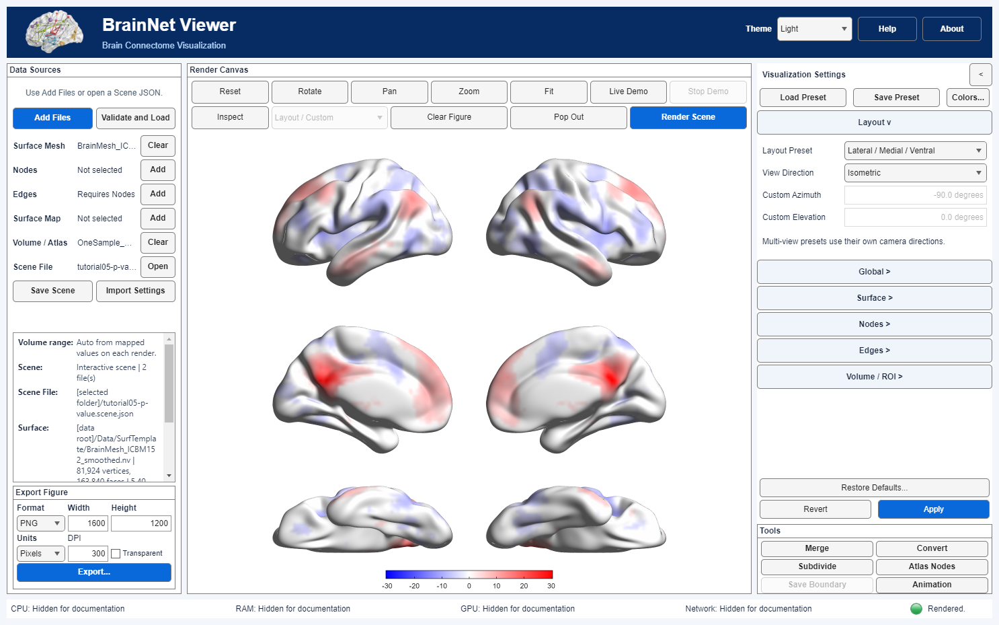

# 窗口布局与截图检查

开发版 + 开发版 · 开发版说明 · 2026-09-19

[English](Window_Layout.en.md) · [迁移说明](Migration.zh-CN.md)

主界面现用顶层布局管理器填充实际可见区域，响应式列宽依据根面板可用宽度，不再反复复制窗口请求尺寸。正常缩放或最大化/还原即可；Apply/Revert及暂存编辑仍沿用同一工作流。

窗口改变不自动Reset、Fit或改写科学相机。纵横比变化仍会影响能看到的范围，需要时主动使用Fit。画布继续采用原有归一化多视图轴区域及独立缩放策略。

渲染器现于首次绘制后固定已解析的初始相机和轴范围。此前未点击Fit时，自动范围可能随窗口缩放改变；这与窗口截图尺寸不一致是两个问题。新增回归覆盖全部五种布局未先点击Fit的路径。

Data Sources下方的**Export Figure**仍按设置尺寸导出科学脑图。整窗截图是另一件事：包含界面，可能额外包含原生菜单条。内部验收分别记录请求窗口尺寸、客户区可用尺寸和截图尺寸，不将三者混为一谈。

验证辅助等待布局完成，检查图像尺寸与客户区对应关系及长条纯黑边，最多尝试3次，仍不同步则明确失败。不会裁切、缩放或补画截图以凑验收。这是开发验证工具，并非新增用户截图菜单，也不替换Export Figure。

范围限制：专项验证异常发生于不同的单屏显示会话；本轮当前双屏环境下，修改前的普通窗口对照未重现历史裁切。管理布局移除了脆弱的手工尺寸复制路径，但不认证所有远程桌面/DPI条件。若再次出现裁切，请保留整窗截图、Scene、窗口状态、显示器分辨率/缩放及窗口操作顺序供复核。部分窄窗文字截短和深色控件对比度仍待处理。

详见实现与验证报告。本说明为开发文档，不表示通过发布验收。

GS05内部验收图包含本地输入路径，不是已清权的公开教程素材。固定的底部Apply/Revert保持可见，设置区域独立滚动。960宽窗口部分左栏内容需滚动，文字截短仍待优化。

专项验证对新渲染按实际几何及就位后的面板尺寸执行一次Fit，多视图共享相机距离/角度；窗口缩放仍不自动Fit。保存的相机状态显式保留，旧Scene若视角过大仍需手动Fit。完整字框越出面板时整条标签暂时隐藏，相机/尺寸变化后重算可见性，不截短文字；不解决标签碰撞，不认证所有DPI或导出格式。
