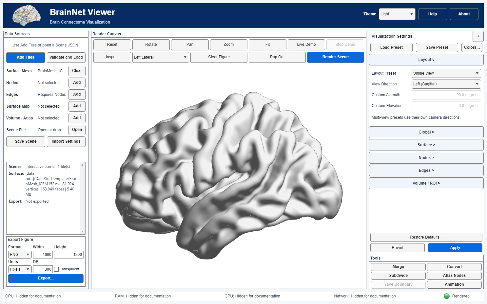

# 00 · First launch and first figure

[中文](../zh-CN/00_First_Launch.md) · [Tutorial index](index.md) · [Getting started](../../documentation/Getting_Started.en.md)

Load the ICBM152 brain surface, render it in the main canvas and save a PNG with its provenance sidecar. This tutorial describes the MATLAB desktop App.

## Input and prerequisites

Use the project's existing [`BrainMesh_ICBM152.nv`](../../../src/matlab/BrainNetViewer/Data/SurfTemplate/BrainMesh_ICBM152.nv) at `src/matlab/BrainNetViewer/Data/SurfTemplate/BrainMesh_ICBM152.nv`, SHA-256 `471e43f955a1cb9f0350aaca2822f02fc74e393718d1e385fddaf0e578ffe572`. It is a real human-brain surface template with **81,924 vertices and 163,840 triangular faces**, not a participant scan. Credit **Prof. Alan C. Evans (MNI)** in redistributed material; see the [source and coordinate note](Resource_Attribution.md).

This exercise uses Windows, MATLAB R2025a Update 1 and the project root directory. A MATLAB Runtime-only package is not supplied. Consult the installation guide before using another platform. Start with a clean MATLAB path and avoid loading another BrainNet Viewer installation.

## Steps

### Step 01

In MATLAB, set **Current Folder** to this project's root (the directory containing the top-level `BrainNetViewer.m`) and run:

```matlab
app = BrainNetViewer;
```

Expected: the English BrainNet Viewer main window opens.  If MATLAB resolves another `BrainNetViewer`, correct the path before continuing.

### Step 02

In **Data Sources**, click **Add Files** and select `Data/SurfTemplate/BrainMesh_ICBM152.nv` as **Surface**. A local copy elsewhere can also be selected directly; no import confirmation or automatic copy is needed. Use **Open Scene** for Scene JSON/ZIP, not for an `.nv` mesh.

### Step 03

Click **Validate and Load**. Expected: the Surface source appears in the Scene summary without a missing-file error. The mesh has **81,924 vertices and 163,840 triangular faces**; this exercise adds no nodes, edges, volume or scalar map. Do not infer verified stereotaxic coordinates from the filename alone.

### Step 04

In **Visualization Settings → Layout**, select **Single View** and **View Direction → Left (Sagittal)**. In **Surface**, choose **Color Mode → Uniform** and set **Opacity** to **1**. Click the shared **Apply** once: it commits the settings **and renders** the brain surface in the central canvas. **Render Scene** is only needed for an explicit redraw.



*Current-build full-window capture; paths and machine details are hidden by the App's display-only documentation mode. Surface provided by Prof. Alan C. Evans (MNI).*

### Step 05

Use the canvas **Fit** control if the surface is too small or off-center. In **Export Figure** below Data Sources, select **PNG**, **Pixels**, **1600 × 1200** and **300 DPI**; leave the background white. Click its export button (**Export...** or **Export Figure**, depending on window width) and choose a new `first-view.png`. Expected: `first-view.png` and `first-view.png.provenance.json` are created. Check the exported pixel dimensions, local paths in the sidecar and template redistribution rights before sharing.

For a **new** selection of this exact bundled file, the App now records the [source metadata and Evans/MNI credit](Resource_Attribution.md) in its Scene and sidecar. Older exported artifacts may retain the earlier generic `user-provided-not-for-redistribution` marker; do not silently edit historical provenance.

## Checks, errors and image slots

- Correct first figure: one cortical surface in a lateral single view, with no nodes, edges or statistical colorbar. Exact pixels depend on graphics settings and are not a scientific fingerprint.
- If **Validate and Load** reports a missing file, verify the selected path or repeat the approved staging step. Never substitute an unrelated brain template silently.
- If **Export Figure** is disabled, first confirm that Apply completed a current render. Do not overwrite an existing output you need to keep.

Continue with [01 · Surface basics](01_Surface_Basics.md). This display exercise does not validate registration accuracy or statistical inference.
