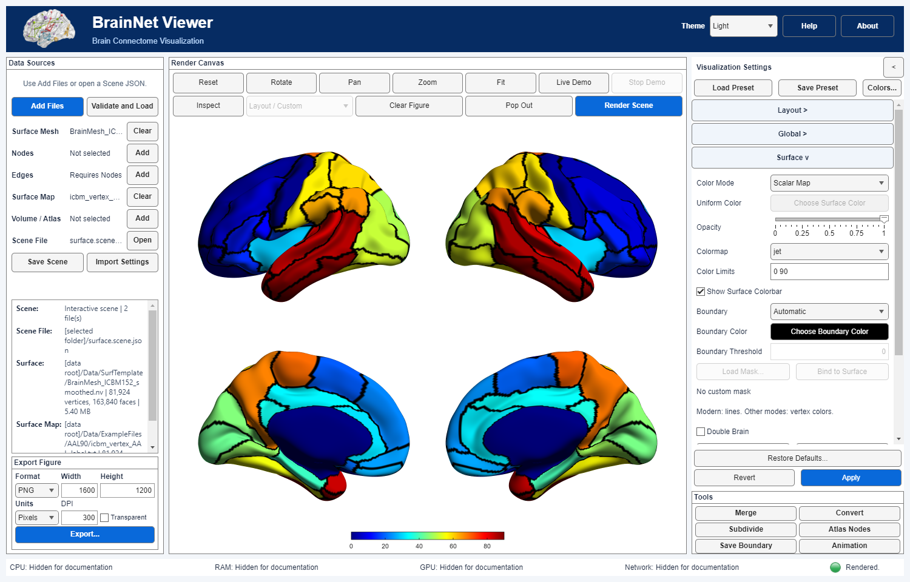
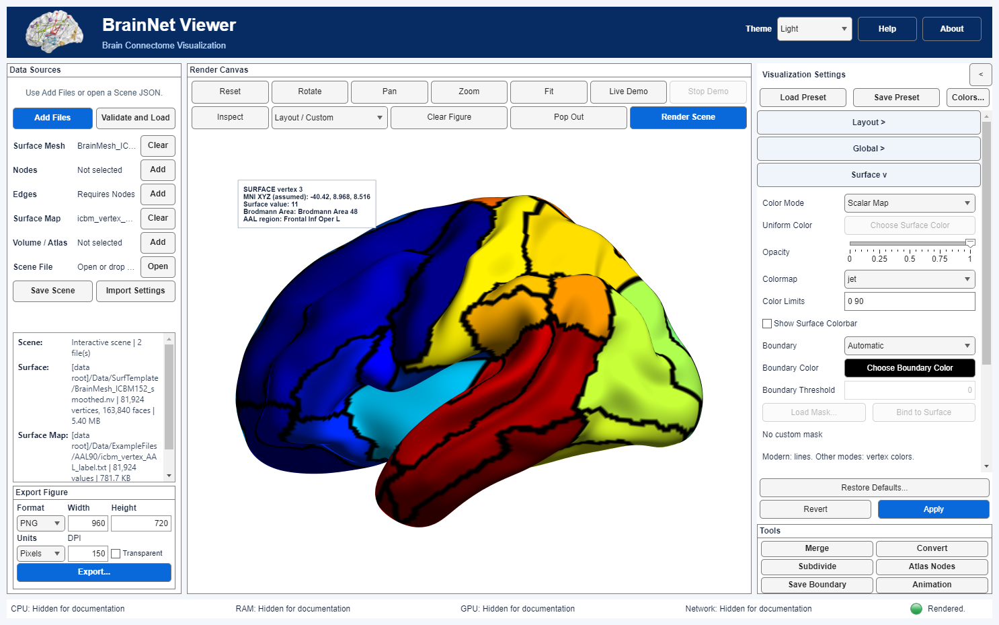

# 04 · Real AAL vertex labels and surface boundaries

[中文](../zh-CN/04_Vertex_Maps_and_Boundaries.md) · [Tutorial index](index.md) · [Surface controls](../../manual/en/M06_Surface.md)

Display the historical AAL vertex-label map on its matched smoothed ICBM152 surface, show categorical boundaries, and inspect a visible surface vertex. See the [material sources and interpretation](Resource_Attribution.md).

## Data and interpretation

Load [`BrainMesh_ICBM152_smoothed.nv`](../../../src/matlab/BrainNetViewer/Data/SurfTemplate/BrainMesh_ICBM152_smoothed.nv) as **Surface** and [`icbm_vertex_AAL_label.txt`](../../../src/matlab/BrainNetViewer/Data/ExampleFiles/AAL90/icbm_vertex_AAL_label.txt) as **Surface Map**. Use this surface and vertex-map pairing. The map SHA-256 is `7cd6b8aa19c2aae6161015d62d22770a1fdfdf61d7e29354e8174dbd7853d131`. It contains **81,924** integer vertex labels; 79 distinct IDs occur, spanning 0–90. ID 0 occurs **7,352** times and is treated as unlabeled/background; the remaining **74,572** vertices have positive IDs. “AAL90” does not mean all 90 positive IDs occur on this mesh. Read the [source, compatibility and rights note](Resource_Attribution.md) before using the image in a publication.

This table is a categorical atlas-derived projection, **not** a statistical map. The local materials cite Tzourio-Mazoyer et al., *NeuroImage* 15:273–289 (2002), but do not establish the exact atlas version, projection algorithm or spatial-registration accuracy.  Tested on Windows/MATLAB R2025a Update 1; runtime and peak memory were not measured.

| Control | Exercise value | Interpretation |
|---|---|---|
| Layout → Preset / View Direction | Lateral / Medial | Four lateral and medial hemisphere views |
| Surface → Color Mode / Opacity | Scalar Map / 1 | Display original-order label IDs on an opaque mesh |
| Surface → Colormap / Color Limits | Jet / `0 90` | Assign display colors to IDs; numerical order has no anatomical magnitude meaning |
| Surface → Show Surface Colorbar | On | A numeric lookup scale for label IDs, not a ranked effect size or named AAL legend |
| Surface → Boundary / Boundary Color | Automatic / black | Outline transitions between integer label IDs |

## Steps

### Step 01

From the project root, launch `app = BrainNetViewer;`. In **Data Sources → Add Files**, choose the smoothed ICBM152 `.nv` as **Surface**, then the AAL `.txt` as **Surface Map**. Click **Validate and Load**. Expect one 81,924-vertex/163,840-face mesh and one 81,924-value map, without nodes, edges or a NIfTI volume. The older unsmoothed ICBM152 mesh has identical face indices but different coordinates; this lesson deliberately uses this surface and vertex-map pairing.

### Step 02

In **Visualization Settings → Layout**, select **Lateral / Medial**. In **Surface**, set **Color Mode → Scalar Map**, **Opacity → 1**, **Colormap → Jet**, **Color Limits → `0 90`**, enable **Show Surface Colorbar**, choose **Boundary → Automatic**, and keep **Boundary Color** black. Click the shared **Apply** to commit and render. Expected: multiple colored atlas-derived patches separated by black transition lines. A color is an ID encoding, not a ranked value, effect size or probability. The line follows mesh transitions and can look angular at triangle scale.



*Current-build English full-window capture. The App's display-only documentation mode hides local paths; settings, Scene data and raw provenance were not altered. Source-surface credit: Prof. Alan C. Evans (MNI); atlas citation: Tzourio-Mazoyer et al. (2002). *

### Step 03

With this current render, use **Tools → Save Boundary** and choose a **new** `.txt` path. This number applies only to the pinned input pair/settings; it is not a count of AAL regions. Do not overwrite an earlier boundary file. The output has provenance comments; check for local paths before sharing.

### Step 04

To verify that the intended file is loaded, run this from the project root:

```matlab
sourceRoot = fullfile(pwd,"src","matlab","BrainNetViewer");
addpath(sourceRoot);
ref = brainnet.core.InputReference("surface_map", ...
    "Data/ExampleFiles/AAL90/icbm_vertex_AAL_label.txt", ...
    Sha256="7cd6b8aa19c2aae6161015d62d22770a1fdfdf61d7e29354e8174dbd7853d131");
ids = brainnet.io.readSurfaceMap(ref,sourceRoot);
[numel(ids),numel(unique(ids)),sum(ids==0)]  % [81924 79 7352]
```

After **Apply**, **Save Scene** records the two input references and display settings; the JSON does not embed the atlas table.

### Step 05 · Inspect the mapped left surface

With the same two inputs and scalar-map settings, change **Layout → Preset** to **Single View** and **View Direction** to **Left (Sagittal)**, then click **Apply**. Click **Inspect** on the canvas toolbar and then a visible colored surface point. The label appears in the canvas; click **Inspect** again to exit and clear it.  Inspect picks a source vertex, not a region patch or boundary line.



*Focused R2025a capture on the AAL map/ICBM pair, refreshed after a figure export so the inferior temporal surface is fully visible. At the illustrated vertex 3, the displayed map ID and the independent AAL lookup ID both equal **11**; the lookup reports **Frontal Inf Oper L** and **Brodmann Area 48**. This is one local consistency check, not proof that every vertex was projected or registered correctly. The canvas label was inset to keep it inside the view.*

## Errors and scientific limits

- **Wrong input role or missing map:** choose `.txt` as **Surface Map**. Scalar Map cannot create atlas labels from a mesh alone.
- **Different surface or vertex ordering:** matching length alone does not establish correspondence. Do not bind this table to an unrelated mesh merely to obtain a plausible picture. Compare the pinned hashes and the local projection protocol before scientific use.
- **Atlas IDs are categories:** do not interpret `90 > 10` as a stronger effect, and do not use Surface **Boundary Threshold** as a statistical test. Automatic shows ID transitions; see [boundary semantics](../../documentation/Surface_Boundaries.en.md).
- **Version and registration:** this exercise reproduces the local historical AAL-derived visualization. This does not independently validate the source AAL version, labels-to-surface projection or coordinate transform. The separate volume-based Inspect lookup agrees at the illustrated point only; it is not a verification of every vertex label here.
