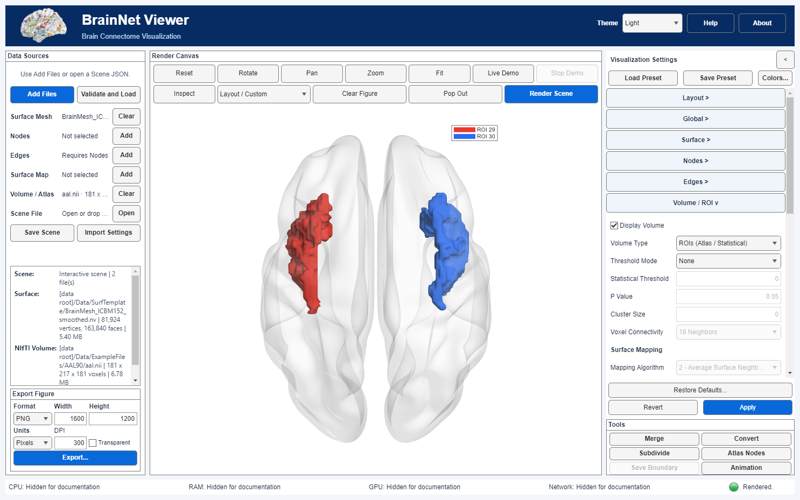
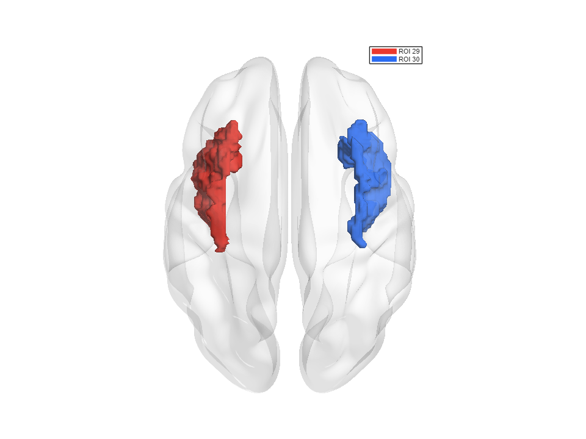

# 06 · Bilateral insula ROIs from the real AAL atlas

[中文](../zh-CN/06_AAL_Insula_ROIs_and_Inspection.md) · [Tutorial index](index.md) · [ROI/Inspect manual](../../manual/en/M10_ROI_Inspection.md)

This lesson uses the bundled historical `aal.nii` to draw the **left and right insula**, rather than creating ROIs from a statistical T map. See the [exact-file source and version note](Resource_Attribution.md). The AAL90 citation is Tzourio-Mazoyer et al., *NeuroImage* **15**:273–289 (2002). The local file has not been independently matched byte-for-byte to a particular upstream archive; do not silently replace it with AAL3v2, which is a later atlas version. The source surface requires separate credit to Prof. Alan C. Evans (MNI).

In this exact `aal.nii` (SHA-256 `2926fcc98efc709f77c8cca2f9c1d797eba3e9a1b222a8e0cfa70ab131394c80`), **29 = Insula L** (15,025 voxels) and **30 = Insula R** (14,128 voxels). These are atlas categories, not effect sizes or P values. The corresponding bundled AAL label MAT reports the same names for those IDs. No statistical threshold is appropriate for this categorical atlas.

| Control | Exercise value | Why |
|---|---|---|
| Layout → Layout Preset / View Direction | Single View / Superior (Axial) | One brain from above, with both insulae visible. |
| Surface → Opacity | `0.15` | Reveal the deeper ROIs through the anatomical surface. |
| Volume / ROI → Display Volume / Volume Type | on / ROIs (Atlas / Statistical) | Draw selected AAL labels as 3-D ROIs. |
| Threshold Mode | None | Preserve integer atlas IDs without statistical filtering. |
| Draw All ROIs / ROI Selection | off / `29, 30` | Only the bilateral insula; selection is disabled while Draw All is on. |
| ROI Color Mode / Custom Colors | Custom / `29 0.92 0.22 0.18`; `30 0.16 0.42 0.95` | Stable red/blue categorical colors for left/right. |
| ROI Smoothing / Smoothing Kernel | Gaussian / `3` | Soften display meshes, not the stored label volume. |
| Show ROI ID Legend | on | Show IDs 29 and 30; this is not a continuous colorbar. |

## Steps

### Step 01

Launch `app = BrainNetViewer;`. In **Data Sources → Add Files**, choose [`BrainMesh_ICBM152_smoothed.nv`](../../../src/matlab/BrainNetViewer/Data/SurfTemplate/BrainMesh_ICBM152_smoothed.nv) as **Surface Mesh** and [`aal.nii`](../../../src/matlab/BrainNetViewer/Data/ExampleFiles/AAL90/aal.nii) as **Volume / Atlas**. Click **Validate and Load**. Check that the volume is 181 × 217 × 181 with 1 mm voxels. These project files are used in their stored MNI-like coordinates; the App does not perform registration, and this lesson is not an independent spatial-alignment audit.

### Step 02

Set **Layout Preset → Single View** and **View Direction → Superior (Axial)**; set **Surface → Opacity → 0.15**. In **Volume / ROI**, turn **Display Volume** on, choose **ROIs (Atlas / Statistical)** and **Threshold Mode → None**. Turn **Draw All ROIs** off, enter `29, 30` in **ROI Selection**, select **ROI Color Mode → Custom** and enter/load the two `ROI_ID R G B` rows in the table above. Set **ROI Smoothing → Gaussian**, **Smoothing Kernel → 3**, turn **Show ROI ID Legend** on, and click the shared **Apply** button. Expect two bilateral insula meshes, not all AAL regions. If Custom Colors reports missing rows, supply both IDs; it does not silently choose fallback colors.

*Current-build English full-window capture, with local paths hidden at display time. The focused R2025a check read both local atlas labels, rendered exactly two ROIs in a single superior view, showed an ID key and did not draw a continuous scalar colorbar. AAL source: GIN/MNI; cite Tzourio-Mazoyer et al. (2002). Surface source: Prof. Alan C. Evans (MNI).*

*960 × 720 PNG from a fresh App instance after reopening the saved Scene; the two selected IDs and the categorical legend persisted.*

### Step 03 · Continue to surface Inspect

**Inspect picks a visible surface vertex or node, not an ROI mesh.** For an anatomical lookup on a clearly colored target, follow [Tutorial 04, Step 05](04_Vertex_Maps_and_Boundaries.md): use the AAL **surface vertex map** in a **Left (Sagittal)** single view.  The two insula ROI meshes in this lesson are selected by IDs `29, 30`; Inspect does not substitute for that ROI Selection. Inspect assumes compatible MNI-like coordinates and does **not** register or verify any input.

## Common mistakes and limits

- `Threshold Mode → P Value` is for a supported statistical image, **not** integer AAL labels. `None` preserves the source IDs.
- The source AAL IDs and Custom RGB table are categorical. The default continuous colorbar applies to scalar maps, while the ROI ID legend identifies categories.
- Gaussian smoothing changes only rendered ROI geometry. It does not alter the source NIfTI, label IDs or true atlas boundary definition. If precise voxel geometry matters, use **ROI Smoothing → None**.
- A newer AAL3v2 file may have different definitions, IDs or spaces; recheck every selection, lookup and saved Scene before switching. Check atlas compatibility when changing versions.
