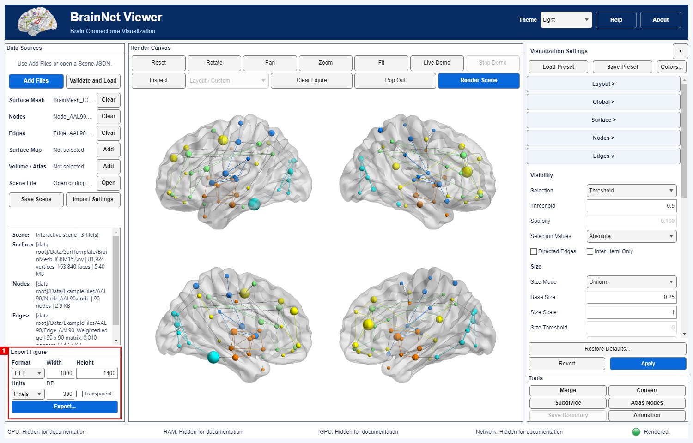

# 07 · Multi-view layout and publication export

[中文](../zh-CN/07_Layout_and_Publication_Export.md) · [Tutorial index](index.md) · [Layout manual](../../manual/en/M04_Layout_Camera.md) · [Export manual](../../manual/en/M12_Export.md)

This lesson reuses the real, **PCC-subregion one-sample connectivity T map** from [Tutorial 05](05_Volume_to_Surface_Mapping.md), on the smoothed ICBM152 mesh. It is not an Alzheimer's-versus-control comparison. The four-view image illustrates page composition and export controls; scientific interpretation and the source and interpretation limits remain those of Tutorial 05.

| Control | Exercise value | Purpose |
|---|---|---|
| Layout → Layout Preset | Overview (8 views); Lateral / Medial (4); + Ventral (6); + Dorsal (5) | Compare complementary views at a shared scale; choose the least crowded composition that answers the scientific question. |
| Surface → Show Surface Colorbar | On | Preserve the continuous signed T-value key. |
| Export Figure → Format | TIFF | Lossless raster output suitable for downstream page assembly. |
| Export Figure → Units / Width / Height | Pixels / `1800` / `1350` | Set actual pixel dimensions; at 300 pixels per inch, the intended placement is 6 × 4.5 inches. |
| Export Figure → DPI / Transparent | `300` / off | Request 300 DPI metadata on white; check the downstream file and journal instructions. |

## Steps

### Step 01 · Restore the real-data four-view Scene

Complete [Tutorial 05 Steps 01–02](05_Volume_to_Surface_Mapping.md), or open a Scene JSON you saved there and click **Validate and Load → Render Scene**. The inputs must be the exact `BrainMesh_ICBM152_smoothed.nv` and `OneSample_ROI11_NC.nii` files in that lesson. Keep the same P-value, mapping algorithm and colormap for the comparisons below; change only **Layout Preset**, then click the shared **Apply**. The focused R2025a check rendered 8, 4, 6 and 5 panes respectively, each with one signed colorbar. **View Direction** is not used by these multi-view presets; each has preset-specific cameras. Overview resolves to **8 views only for a safely divisible two-hemisphere surface** such as this mesh; an indivisible mesh falls back to 6 full-surface views.

### Multi-view gallery on the same T map

**Overview (8 Views)** combines lateral, medial, superior, inferior, anterior and posterior information for a survey. Its individual brains are smaller and may not be ideal for a narrow journal column.

**Lateral / Medial (4 views)** enlarges the two exterior and two medial faces. Use it when those surfaces carry the important effects; this is the export example below.

**Lateral / Medial / Ventral (6 views)** adds two outward-rotated inferior faces. Check the colorbar and ventral details at the final placement size.

**Lateral / Medial / Dorsal (5 views)** adds a central superior whole-brain view without a redundant second dorsal pane.

*All four images use the same one-sample T map, smoothed ICBM152 mesh and signed color scale; only the preset changes. They are current-build English App captures with local paths hidden at display time. Their 8/4/6/5 pane counts and single colorbar passed a focused R2025a check; no quantitative image-equivalence or print-size comparison was performed.*

### Step 02 · Choose the output dimensions

Return to **Lateral / Medial** and click **Apply**. In **Export Figure** below Data Sources, select **TIFF**, **Pixels**, **Width 1800**, **Height 1350**, **DPI 300**, and leave **Transparent** off. Export uses the rendered Scene, not a screenshot of the whole App. Click **Export...** and select a **new** `.tif` path. Avoid replacing an existing figure without reviewing it.

*Current-build R2025a English full-window capture, with local paths hidden only on screen. The focused export produced a TIFF with exactly **1800 × 1350 pixels** and a neighboring `.provenance.json`; the image is a one-sample connectivity T map, not a disease-group contrast. Volume source: Xia et al. (2014); surface credit: Prof. Alan C. Evans (MNI).*

### Step 03 · Verify before submission

The red frame in the following AAL90 example identifies the same **Export Figure** panel. It uses TIFF at 1800 × 1400 pixels and 300 DPI; these are an additional example, not the dimensions of the statistical-map export above.

Open the exported TIFF in the target editing/submission tool, check that all four views and the colorbar are legible at the intended placement size, and inspect its pixel dimensions. The focused R2025a check verified TIFF format, **1800 × 1350** pixels and both exact inputs' status in the sidecar. It did **not** independently validate printed physical size, TIFF DPI metadata in every downstream program, journal-specific color requirements or exact cross-platform typography. Review `.provenance.json` before sharing because raw paths may identify your computer. If a journal demands vector graphics, test its PDF/SVG output in the target workflow: 3-D plots may be rasterized despite the container format.

## Common errors and limits

- **Export unavailable:** render the Scene first. Loading files or a Scene alone is insufficient.
- **Small or cropped panels:** use **Fit** or revise the layout, then inspect the *exported image* rather than judging solely by the interactive window.
- **Scale confusion:** `1800 × 1350` is a pixel count; `300 DPI` is a placement/metadata request. Neither makes low-resolution source data anatomically more precise.
- **Scientific scope:** the underlying threshold is a two-sided, uncorrected voxelwise `P = 0.001` from REST T(37); the four-view layout does not change that inference. Do not relabel this one-sample connectivity example as an AD-versus-control difference.
