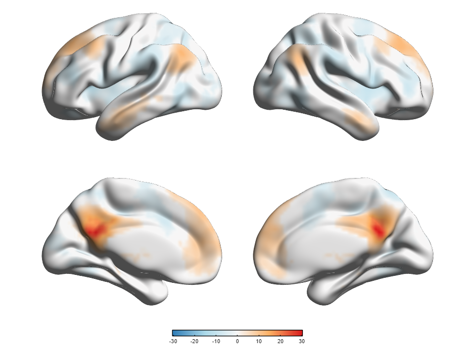

# 09 · Custom colormaps and reusable display presets

[中文](../zh-CN/09_Presets_and_Custom_Colormaps.md) · [Tutorial index](index.md) · [Colormap/preset manual](../../manual/en/M11_Colormaps_Presets.md) · [Real-data interpretation](05_Volume_to_Surface_Mapping.md)

This lesson reuses the real PCC-subregion **one-sample connectivity T map** and smoothed ICBM152 mesh from Tutorials 05–08. It demonstrates a custom *display* palette and a display preset; neither changes the source NIfTI, threshold, statistics or registration. The data are not an Alzheimer's-versus-control group contrast. Keep the [statistical-source note](Resource_Attribution.md) and Prof. Alan C. Evans (MNI) surface credit with any published figure.

The project-created [five-row blue–near-white–red RGB file](../assets/tutorial09-pcc-diverging.colormap.json) is the exact teaching palette (SHA-256 `b2d82b6fa3e65068ebfb394d86bd8daff27b29b69901e42bd31f39f77479e092`). The supplied [display preset](../assets/presets/tutorial09-pcc-diverging.preset.json) is an App-generated example (SHA-256 `27f9037f5f50de4f24a4e2ce3edbc3a94cd69e498e7f9088a28b667bfcd7fad8`). Both are project-created display resources; neither bundles an input file. The preset also contains the real example's layout, `P = 0.001` and volume-mapping choices, so **review it before applying it to a different dataset**.

| Control | Exercise value | Meaning |
|---|---|---|
| **Colors... → Target** | Volume | Edit the one palette consumed by Volume → Surface Map, not Surface/Node/Edge colors. |
| **Import...** | supplied `tutorial09-pcc-diverging.colormap.json` | Load five finite RGB rows in [0,1]; no expressions are evaluated. |
| **Use in Settings → Apply** | both, in that order | Stage the edited palette, then commit and render. |
| **Save Preset / Load Preset** | a new `*.preset.json` / same file | Reuse all applied display settings without replacing input files. |

## Steps

### Step 01 · Restore the real-data Scene

Open [Tutorial 08's four-view Scene](../assets/scenes/tutorial08-pcc-four-view.scene.json) using **Scene File → Open**, then **Validate and Load → Render Scene**. Use the same exact files under the configured data root. The expected starting view is four lateral/medial brains, one signed colorbar and the Tutorial 05 REST T(37), two-sided uncorrected `P = 0.001` mapping. This step does not create a new statistical analysis.

### Step 02 · Import and apply the custom Volume palette

Click **Colors...** in Visualization Settings. In the editor choose **Target → Volume**, then **Import...** and select the supplied RGB JSON. Check the five RGB rows and the blue-to-near-white-to-red preview. The editor's **Preset** dropdown is the *source for Generate*, not a reliable indicator of which imported table is active; trust the current table and preview. Click **Use in Settings** to stage it, then the single **Apply** button at the bottom of Visualization Settings to commit and render. The volume mapping remains signed: the one palette is split around its midpoint for negative and positive values. A named `bwr` or `jet` choice alone is not this custom table.


*MATLAB colormap editor. Project-authored RGB values are illustrative; blue/red hues are not an inference method, and a smooth preview does not guarantee perceptual uniformity or color-vision accessibility.*


*Current-build R2025a English App capture with local paths hidden on screen. The NIfTI, `P = 0.001` and mapping algorithm were not changed by the color edit.*

### Step 03 · Save, perturb and replay a preset

Click **Save Preset** and choose a **new** `.preset.json` path. It saves settings already committed with **Apply**, not pending edits. To check replay, temporarily choose **Volume / ROI → Colormap → Blue-White-Red** and click **Apply**. Then click **Load Preset**, select the file just saved (or inspect the supplied example), read any compatibility review and confirm. Loading the preset retains the current data references but clears the previous render/camera; click **Render Scene**. The five-row custom palette and four-view display should return. The focused R2025a check verified the numeric RGB rows after replay and that the input references were unchanged.



*960 × 720 output after preset reload. Compare the signed colorbar and areas to the prior screen; do not assume pixel-identical replay on another monitor or graphics driver.*

For an optional file-level check in MATLAB, after adding the BrainNet Viewer source folder to the path:

```matlab
rgb = brainnet.io.readColormap("docs/tutorials/assets/tutorial09-pcc-diverging.colormap.json");
size(rgb)  % [5 3]
preset = brainnet.io.readPreset("docs/tutorials/assets/presets/tutorial09-pcc-diverging.preset.json");
volume = preset.Settings.section("volume");
volume.colormap  % the five RGB rows
```

## Scientific and workflow limits

- **Palette ≠ statistic:** changing colors does not change signed T values, the REST T(37) header, voxelwise `P = 0.001`, interpolation or multiple-comparison status. The intermediate RGB rows are interpolated for display.
- **Preset ≠ Scene:** a display preset has no input paths, camera, export-panel preferences or data bytes. [Save Scene](08_Command_Line_and_Scene_Replay.md) records references to a particular dataset and optional session state instead.
- **Different dataset:** loading this example preset on another image can preserve an inappropriate P threshold, color range, ROI selection or layout. Review the warning, statistic metadata, units, registration and resulting figure before scientific use; compatibility is not validity.
- **Cancel / Revert / overwrite:** **Cancel** in the editor discards its edits; **Revert** in Settings discards staged edits; saving a preset before **Apply** captures the old applied settings. Choose new output names unless you explicitly intend to replace files.
