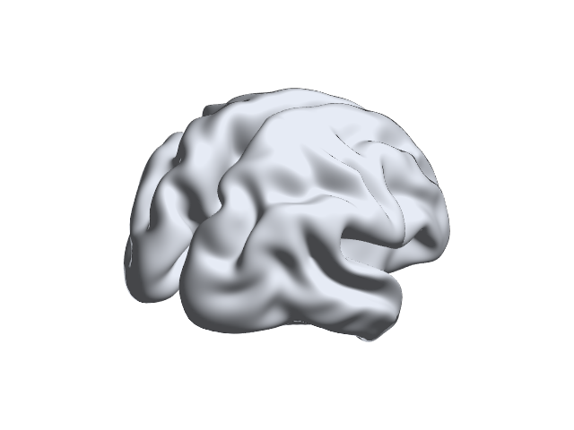
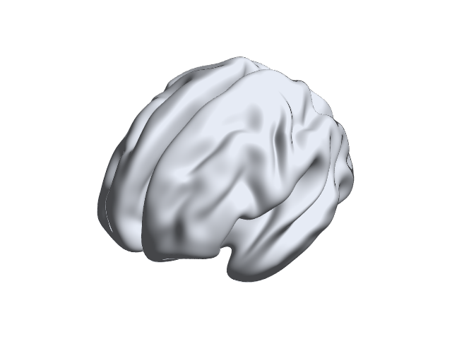

# 12 · Camera animation of a real cortical surface

[中文](../zh-CN/12_Camera_Animation.md) · [Tutorial index](index.md) · [Export manual](../../manual/en/M12_Export.md) · [Animation behavior](../../documentation/Movies.en.md)

This lesson rotates the **camera around a static surface**; it does not animate brain activity or connectivity. It uses the real `BrainMesh_ICBM152_smoothed.nv` (SHA-256 `aff1920baef51956971b8c1de068e8eee2d1279f21fc90452bcd0dba2794fdc5`). Credit Prof. Alan C. Evans (MNI) when distributing the mesh or derived images. The first short PNG sequence checks the workflow with only four frames; for a smooth presentation movie, use more frames after reviewing the output and computing cost.

| Control | Focused exercise | Meaning |
|---|---|---|
| Layout → Preset / View Direction | Single View / Isometric | One 3-D camera; a world-axis orbit is not a change of anatomical coordinates. |
| Surface → Color Mode / Opacity | Uniform / 1 | Opaque neutral surface, without a scalar map or colorbar. |
| Animation → Format / Width / Height | PNG / 640 / 480 pixels | Portable frame sequence, not a video codec. |
| Duration / Frame rate | 1 second / 4 fps | Four test frames; intentionally not smooth playback. |
| World rotation axis / offsets | Z / 0° → 360° | A complete orbit relative to the current camera; the duplicated 360° endpoint is omitted. |
| Safe Fit | On | Fit the entire geometry throughout the orbit on a private renderer. |

## Step 01 · Load and render

Start `app = BrainNetViewer;` from the new project's root. In **Data Sources → Add Files**, choose `Data/SurfTemplate/BrainMesh_ICBM152_smoothed.nv` as **Surface Mesh**, then **Validate and Load**. In **Visualization Settings**, select **Single View**, **Isometric**, **Uniform**, **Opacity 1**, and **Boundary None**, then click the shared **Apply**. The App must have a current Modern Batch Renderer image before animation export is enabled. Optionally use **Fit** or **Rotate** to set the starting camera; this affects the orbit's base camera, not surface coordinates.

## Step 02 · Configure a four-frame PNG orbit

Choose **Tools → Export Animation...**. Set the parameters in the table. The window exports the *current rendered Scene* into a **new folder**, not a single `.png` or a replacement for the main canvas. Click **Export...**, select an existing parent folder and give the **new** bundle a name such as `icbm-orbit-check`. Choose a new name for subsequent runs; existing folders are rejected.

*Current-build animation window. Safe Fit protects the exported orbit from clipping but may make the brain smaller than the interactive view.*

## Step 03 · Inspect frames and provenance

The bundle should contain `frame-000001.png` through `frame-000004.png`, `preview.png`, and `provenance.json`. The four frames represent successive views around the static surface; they are not four time points of neuroimaging data. The focused R2025a check inspected 640 × 480 pixel dimensions, four distinct frame hashes, a four-frame manifest, the pinned surface hash, no overwrite, and an unchanged main-canvas camera.

 

 

*Exact output frames from the real surface. Frame 4 approaches, but does not duplicate, the starting view. These stills document the orbit; a four-frame sequence is not a recommended final presentation rate.*

For a smoother result, reopen **Export Animation...** after reviewing the four-frame check, choose a **new** bundle, and try the default **5 seconds / 24 fps / 960 × 720**. MP4 appears only if MATLAB exposes its MPEG-4 profile; AVI is also installation-dependent. PNG is the codec-independent choice for this lesson. Export is offline, so 24 fps is playback timing, not a claim of real-time rendering or GPU encoding. Inspect the resulting `provenance.json` for local paths and private metadata before sharing; the original `.nv` is referenced, not copied.

## Common mistakes and limits

- **Disabled Export Animation:** load, **Apply** and render first; a selected file alone is insufficient.
- **Unexpected framing:** Safe Fit uses an orthographic, rotation-safe fit on the export copy. Turning it off can crop some angles; check every frame.
- **Angle interpretation:** Z is the world axis. A positive orbit follows the right-hand rule relative to the current camera; it does not prove anatomical orientation or spatial registration.
- **No overwrite:** choose a new folder; cancellation and failure should not publish a partial bundle.
- **Data meaning:** this is a camera movie of one static surface. It does not show dynamic functional connectivity, time-varying statistics, surface morphing, or fiber tracking.
