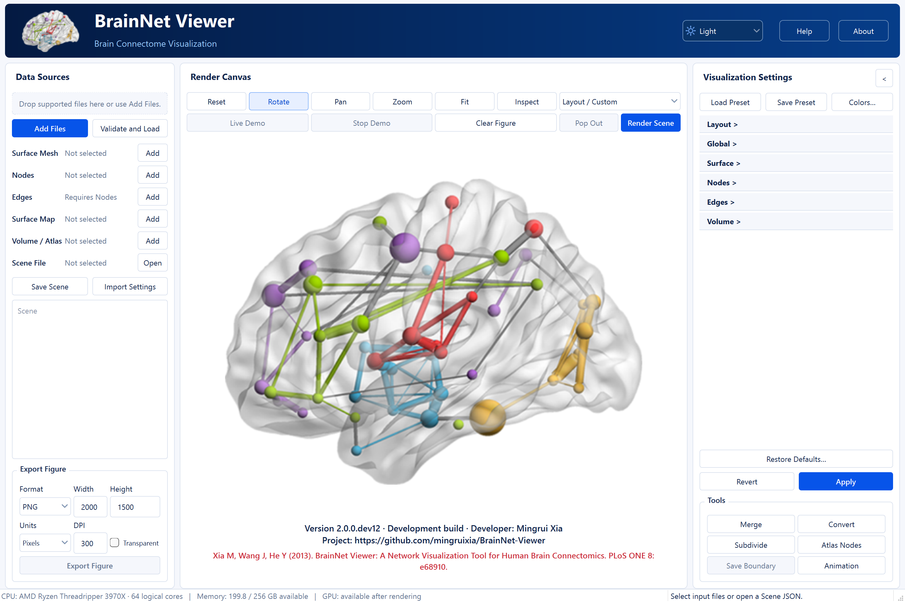

# Install and first launch

[Tutorial index](index.md) · [Next lesson](02_First_Surface_Visualization.md)

Choose MATLAB Desktop if you already use MATLAB, or install Python Desktop in a separate environment. Both lead to the same workflow: select inputs, configure, Apply/render, interact, then save or export. This lesson ends with an open main window; it does not yet load scientific data.

## Choose an edition

MATLAB Desktop needs installed, licensed MATLAB. Python Desktop uses Python, Qt and VTK and does not require MATLAB or SPM. Both need a local graphical desktop; these instructions do not describe a standalone executable, MATLAB Runtime-only package or Docker/browser deployment.

Check the supplied package's compatibility notes and SHA256SUMS. The public beta is named 2.0.0-beta.1; its Python package version is 2.0.0b1. Windows x64 and Apple Silicon macOS have focused development checks; consult release notes for the actual public candidate. Intel Mac, Linux Desktop and other display arrangements require separate validation. For browser use follow the [Docker installation guide](../../../web/en/INSTALLATION.md).

## Launch MATLAB Desktop

1. Open MATLAB and set Current Folder to the project or distribution root containing the top-level `BrainNetViewer.m` launcher. Do not select the frozen original software folder.
2. Run:

```matlab
app = BrainNetViewer;
```

3. Confirm the English main window appears. If MATLAB opens a different BrainNet installation, check `which BrainNetViewer` and correct the path before proceeding. Do not recursively add conflicting installations.

The launcher locates the modern source tree; entering several `addpath` and `brainnet.app.launch` lines is unnecessary when this root launcher is available. A displayed development-build date is not the public release date.

## Install Python Desktop

Obtain the exact supplied wheel and follow the [Python installation guide](../../../python/en/INSTALLATION.md), which contains separate Windows PowerShell and macOS commands, the candidate hash and fixed-dependency requirements. Create a fresh virtual environment rather than copying one between systems. Install the wheel with its `desktop` extra, run `pip check`, then launch with that environment's Python:

```text
python -m brainnet_viewer
```

On Windows without activation, use the interpreter created by the installation instructions:

```powershell
& $bnvPython -m brainnet_viewer
```

The installed Windows graphical launcher is `.venv-bnv/Scripts/brainnet-viewer.exe`. The workspace development launcher is not a substitute for a separately installed package. Do not use source `PYTHONPATH` or change dependency constraints to hide installation errors. Keep the complete error and interpreter/architecture information if installation fails.

## Find the controls

The left column contains **Data Sources**, a Scene summary and **Export Figure**. The central canvas shows the startup artwork until you render inputs. The right column contains **Visualization Settings**, the shared **Revert/Apply** controls and tools.



*Historical Windows Python dev12 illustration reused to identify controls. Its visible version and hardware readout are not current dev20 results. The startup artwork is not a loaded Scene.*

Expand Layout, Surface or another settings section to edit it. Python opens one section at a time. Collapsing the entire settings panel enlarges the canvas. **Apply** commits settings and renders directly; **Render Scene** is available for an explicit redraw. **Revert** discards pending edits. Light/Dark changes the interface theme, not the scientific canvas background.

## Locate the resource library

MATLAB supplies the library under its software data root; in the project it is `src/matlab/BrainNetViewer/Data`. Python supplies it inside the installed package's `resources/Data` folder. With the installed Python environment, locate that folder using:

```text
python -c "from pathlib import Path; import brainnet_viewer; print(Path(brainnet_viewer.__file__).parent / 'resources' / 'Data')"
```

On Windows without activation, replace `python` with `& $bnvPython`. The relevant subfolders include `SurfTemplate`, `ExampleFiles` and `Tutorials`. File pickers use the bundled library where configured. Do not edit installed resources; copy inputs to a working folder if you need to change them.

## Before continuing

Confirm that the main window is complete, that the intended edition/version is displayed, and that its resource library is accessible. If startup fails or the window is incomplete, retain the actual error, OS, MATLAB/Python version, graphics information and a full-window screenshot. Do not diagnose a startup graphics failure as a scientific-data problem.

Continue with [First surface visualization](02_First_Surface_Visualization.md).
