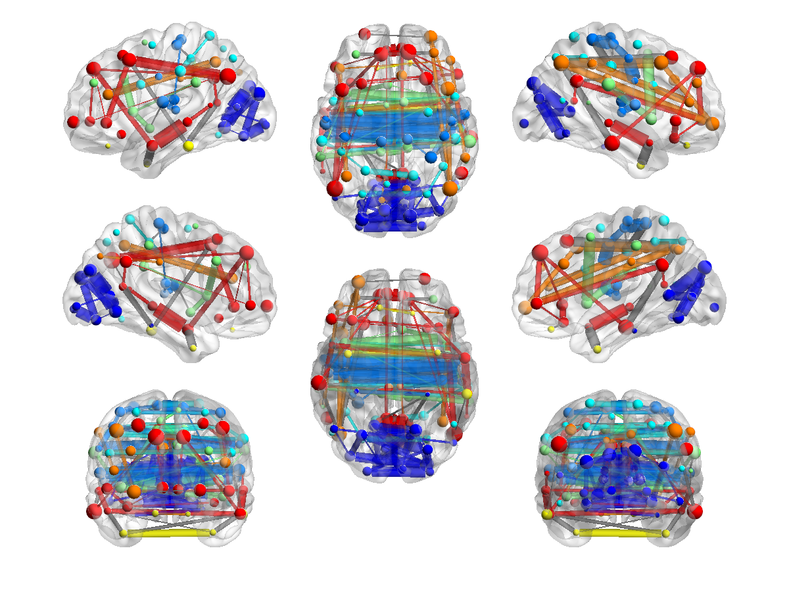

# Nodes modules and connectivity

[Tutorial index](index.md) · [Scene and preset lesson](03_Scenes_and_Presets.md)

Display the real Schaefer100 group network on ICBM152, first as regional nodes and then with connections. Learn how node size, module color and edge selection encode different input quantities. A separate AAL90 exercise preserves the original teaching example without mixing atlas orders.

## Load the matched Schaefer100 inputs

Use these files from your edition's resource library. See [installation and resource locations](01_Installation_and_First_Launch.md) if needed.

| Role | Resource file |
| --- | --- |
| Surface Mesh | `Data/SurfTemplate/BrainMesh_ICBM152.nv` |
| Nodes | `Data/ExampleFiles/AtlasNetworks/Schaefer100Yeo7_GroupFC.node` |
| Edges | `Data/ExampleFiles/AtlasNetworks/Schaefer100Yeo7_GroupFC.edge` |

The node file contains **100 rows**; its companion edge matrix is **100 × 100** in the same region order. Do not pair these nodes with Schaefer200/400 or another atlas's edges. Keep coordinates unchanged. The historical ICBM152 surface supplies anatomical context; its visible folds are not exact parcel boundaries or proof of registration.

The edge example is a group-level connectivity matrix generated from resting-state fMRI data from a group of healthy adults. It is a visualization example, not a normative reference. Node coordinates are atlas-derived volume centroids; module identifiers represent network assignments, and node-size values encode connection strength. The application displays these supplied fields rather than recomputing modules or strength when files are loaded.

## Understand the node columns

A node row has `X Y Z module value label`. Coordinates are columns 1–3, module/color identifiers are column 4, mapped-size values are column 5, and the remaining label identifies the region. These two numeric display fields are independent.

| Display choice | Source and meaning |
| --- | --- |
| Nodes Color Mode → Modules | Treat column 4 as discrete module IDs |
| Nodes Size Mode → Mapped, Size Source → Node Value | Map column 5 to marker radii |
| Nodes Color Mode → Mapped | Map column 4 continuously; this is not the same as categorical Modules |
| Edges Color Mode → Node Module | Use the node-module palette for within-module edges and Inter-module Color for between-module edges |

Choose the Nodes palette or **Colors…** with the Nodes target to edit displayed module colors. IDs remain unchanged; sorted unique IDs determine palette assignment. A numeric module ID is not an effect size. Do not assume that every atlas's module numbers have the same biological meaning or palette ordering. Refer to the distributed atlas notices for network assignment/source details.

## Display nodes before connections

1. Begin with no Surface Map or Volume input and clear unrelated nodes/edges from an earlier exercise.
2. Add the surface and Schaefer100 node file through their separate **Data Sources** controls. Leave Edges empty initially and click **Validate and Load**.
3. Choose **Layout → Lateral / Medial** for four views. In **Surface**, choose **Uniform** gray and **Opacity 0.3**.
4. In **Nodes**, choose **All Nodes**, **Size Mode → Mapped**, **Size Source → Node Value**, **Color Mode → Modules**, and **Label Mode → No Labels**. Python's current mode label is Modules; older tutorial wording may call it Modular.
5. Click the shared **Apply**. Expect regional markers with differing radii and categorical colors. Adjust Base Size/Size Scale if required for readability; this changes display radii, not supplied strength values.

Try **All Labels** briefly and Apply. If labels overlap, choose a smaller subset or increase the exported figure size rather than moving atlas coordinates. A label exactly `-` is suppressed. Restore **No Labels** before the network overview. Node selection, label selection and size mapping are separate controls; selecting Node Value uses column 5, not a camera-dependent marker size.

## Add the network

1. Add the matched Schaefer100 edge file and click **Validate and Load**. Check the matrix dimensions and node count in the Scene information.
2. Choose **Overview (8 Views)**. This separable ICBM152 mesh supports the hemisphere layout; View Direction becomes unavailable because the preset supplies its own cameras.
3. Retain **Surface Opacity 0.3**, node **Modules** color, **Mapped** size and **No Labels**.
4. In **Edges**, choose **Sparsity (Top Count)**, set Sparsity to `0.03`, choose **Selection Values → Absolute**, turn **Directed Edges** off, and select **Color Mode → Node Module**. Retain the loaded size controls for this initial overview, or explicitly record any thickness adjustment you make.
5. Click **Apply** and review the complete eight-view drawing.

*Existing Python Desktop real-data illustration, reused from the Python tutorial collection. It shows the Schaefer100 example, not AAL90 and not a newly captured dev20 or MATLAB result. Exact camera framing, colors and thickness depend on the applied settings and renderer.*

Sparsity is a fraction: `0.03` requests a sparse top-count display, not a value of `3` entered as a percentage. It ranks eligible nonzero candidates and does not rewrite the matrix. Additional selection filters, direction and ties affect the final number of visible connections, so this lesson does not prescribe an identical edge count across configurations. **Threshold** is a different mode using a weight cutoff; it is not a P-value test.

In Node Module color mode, within-module connections inherit node-module colors. Between-module connections use **Inter-module Color**. Changing an Edges mapped colormap does not override the Nodes module palette. If the visible node colors should match the within-module links, keep Nodes in Modules mode.

## Explore size color and direction

Use **Uniform** edge size for equal display thickness, or **Mapped** to encode effective weights. Selection Values, size, color and opacity can have separate signed/absolute settings; changing one does not establish the others. Record the settings used when comparing figures. A thin or transparent retained edge can be difficult to see without having been filtered out.

Use **Length** color only to encode straight-line distance between node coordinates. Its current Length Threshold default is `75` in input coordinate units; it is not white-matter tract length or surface geodesic distance. Network cylinders are links, not reconstructed fiber bundles.

Keep this connectivity example undirected. Use **Directed Edges** and arrow length/width controls only when the input's direction has a meaningful interpretation; turning on arrowheads does not establish causal connectivity. For a multi-view drawing, Rotate/Pan/Zoom manipulates the intended subplot, while Reset restores the layout cameras.

## Retain the AAL90 teaching example

For a separate exercise, clear the Schaefer node and edge roles and load:

| Role | Resource file |
| --- | --- |
| Surface Mesh | `Data/SurfTemplate/BrainMesh_ICBM152.nv` |
| Nodes | `Data/ExampleFiles/AAL90/Node_AAL90.node` |
| Edges | `Data/ExampleFiles/AAL90/Edge_AAL90_Weighted.edge` |

This historical node table has **90 rows** and its matrix is **90 × 90**. It is not the current AAL3v2 example and its module field must not automatically be interpreted as Schaefer/Yeo assignments. Its size values remain the supplied column-5 quantities; do not transfer the Schaefer strength interpretation without source information.

For nodes alone, use **Lateral / Medial**, gray **Surface Opacity 0.3**, **All Nodes**, **Mapped / Node Value** size, **Modules** color and **No Labels**, then Apply.

*MATLAB Desktop illustration with the original AAL90 node table. This is a different dataset from the Schaefer100 figure above.*

Add its paired edge file and set **Threshold `0.5`**, **Selection Values → Absolute**, **Directed Edges off**, **Size Mode → Uniform**, **Base Size `0.25`**, and **Color Mode → Node Module**, then Apply.

*MATLAB Desktop illustration of the historical AAL90 network at the documented weight threshold. Its density is not the Schaefer `0.03` sparsity example; the image is not a current Python acceptance result.*

## Save export and report

After reviewing the drawing, use [Save Scene](03_Scenes_and_Presets.md) to preserve the input-plus-display combination, or a preset for appearance alone. Export only after the current configuration renders. Review labels, contrast, line thickness and module-color interpretation at the final output size. Keep the image with its provenance sidecar, and check metadata for private information before sharing.

Cite the atlas actually used. Schaefer source and release information are available through the [CBIG atlas repository](https://github.com/ThomasYeoLab/CBIG/tree/master/stable_projects/brain_parcellation/Schaefer2018_LocalGlobal/Parcellations/MNI) and the bundled `notices/NOTICE_ATLAS_NETWORK_EXAMPLES.md`. For the historical AAL90 material and surface, retain the [existing attribution](../../en/Resource_Attribution.md). Software reference: Xia M, Wang J, He Y (2013), *PLoS ONE* 8:e68910. No display setting establishes statistical significance or atlas-to-surface registration.

Continue with [Vertex maps boundaries and Inspect](05_Vertex_Maps_Boundaries_and_Inspect.md).
