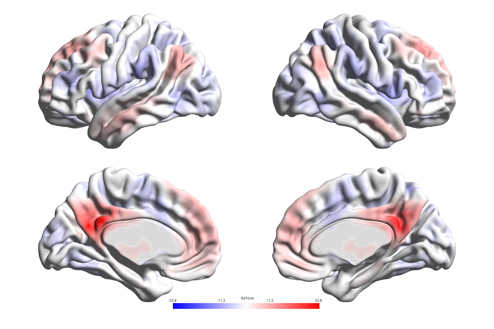

# Statistical volume to surface mapping

[Tutorial index](index.md) · [Previous lesson](05_Vertex_Maps_Boundaries_and_Inspect.md) · [Next lesson](07_AAL_Insula_ROIs.md)

Map a real PCC-subregion seed connectivity statistical volume onto ICBM152 in four views. Configure a metadata-derived P threshold and compare two display sampling methods. Surface colors represent sampled statistics, not P values or independently tested vertices.

## Select the real inputs

Load `Data/Tutorials/OneSample_ROI11_NC.nii` through **Volume / Atlas**. Use your edition's documented surface: MATLAB's existing illustrated exercise uses `Data/SurfTemplate/BrainMesh_ICBM152_smoothed.nv`; Python's uses the original `Data/SurfTemplate/BrainMesh_ICBM152.nv`. Both are credited to **Prof. Alan C. Evans (MNI)**. Unlike a per-vertex text table, a volume is sampled spatially using its affine; this does not register unrelated inputs.

The volume is a one-sample functional-connectivity T map in standard MNI space from the author's PCC-subregion seed analysis. It is **not** an Alzheimer's-versus-control contrast. The documented file has 61 × 73 × 61 voxels, 3 mm spacing, and a description of `REST{T_[37.0]}` identifying T with 37 degrees of freedom. File SHA-256: `e27d9eca7e20f31ed090e410fdb5b4a409565c2fafc3bc86dff21277e58aad5f`. See the [existing resource and interpretation note](../../en/Resource_Attribution.md).

## Configure a shared starting example

1. Clear previous Nodes, Edges and **Surface Map** inputs. Add the surface and volume in their correct roles and click **Validate and Load**.
2. Choose **Layout → Lateral / Medial** for four views. Set **Surface Opacity `1`** and enable **Show Surface Colorbar**.
3. In **Volume / ROI** (Python: **Volume**), enable **Display Volume** and select **Volume Type → Surface Map**.
4. Set **Threshold Mode → P Value**, **P Value `0.05`**, **Display Values → Positive & Negative**, and the blue-white-red Volume colormap (`bwr`). Leave ranges on Auto for this first example; check for manual limits retained from a previous dataset.
5. Choose mapping **algorithm 2**, then click the shared **Apply**. Python labels this Nearest + Surface Smoothing; MATLAB's wording describes averaging surface neighbors. The operation samples nearest voxels and averages over connected surface neighbors, including the vertex itself.

*Python Desktop ICBM152 mapping with algorithm 2 and P=0.05. Pale regions reflect sampling and color configuration, not proof of an absent effect.*

P must lie strictly between 0 and 1. Recognized SPM/REST/DPABI descriptions or supported statistical intents provide the statistic and required degrees of freedom. Missing, contradictory or invalid metadata must be resolved; the filename or range of values cannot establish the test. Review the inferred statistic, df, cutoff and tail rather than substituting an assumed df.

## Compare trilinear sampling

Change only **Mapping Algorithm** to **5 — Trilinear Interpolation**, Apply and compare the appearance. Algorithm 5 interpolates within the thresholded volume; algorithm 2 averages sampled values over mesh neighbors. They are different smoothing/sampling operations and need not yield identical boundaries or amplitudes.

The older MATLAB illustrated example below instead uses **P=0.001**, algorithm **5** and the **smoothed** surface. To reproduce that example, set all three explicitly rather than comparing it with the preceding Python image as though only the renderer changed.

*MATLAB Desktop illustration at P=0.001, algorithm 5. The source tutorial reports a two-sided T(37) cutoff of approximately |T|≥3.5737 for that setting. This historical result is not a new calculation or the cutoff for P=0.05.*

Both interpolation and neighbor averaging can blend retained values with zero/background and attenuate edges. A visible vertex is not itself a voxelwise significance test. Algorithm 1 provides nearest-voxel sampling without these display averages, but still does not supply registration or corrected inference.

## Interpret threshold colors and performance

T/R/Z P conversion is two-sided; F uses an upper-tail test. These are **uncorrected voxelwise** thresholds, not FWE/FDR or cluster-level correction. In **Surface Map + P Value** mode, the ROI Cluster Size filter does not apply. The separate Cluster mode and statistical ROI drawing have their own filtering behavior.

Positive & Negative uses the two halves of one diverging palette. The colorbar represents sampled T values. **Adjust Null** controls how zero/null values appear rather than changing statistical inference; Python uses the original surface color as its effective null color, while MATLAB has edition-specific null-color controls. Review the scientific background and ranges instead of using the interface theme as a figure-background setting.

MATLAB's documented numerical GPU route is limited to supported operations, including algorithms 1 and 5 with fallback. Current Python numerical volume mapping is CPU-based; GPU graphics rendering is not GPU mapping acceleration. This lesson makes no shared speedup claim.

## Save and review

Save a same-edition Scene after Apply and inspect its replay using [Scene instructions](03_Scenes_and_Presets.md). Export the complete four-view brain/colorbar and retain the provenance sidecar. Check signs, thresholds, ranges and source coordinates before scientific interpretation. An empty or pale map may reflect a cutoff, null display or sampling choice; it is not automatically a biological conclusion.

Data reference: Xia M, Wang Z, Dai Z, Liang X, Song H, Shu N, Li K, He Y (2014). Differentially disrupted functional connectivity in posteromedial cortical subregions in Alzheimer's disease. *J Alzheimers Dis* 39:527–543. The paper citation identifies the source study, not the type of contrast in every distributed map.
