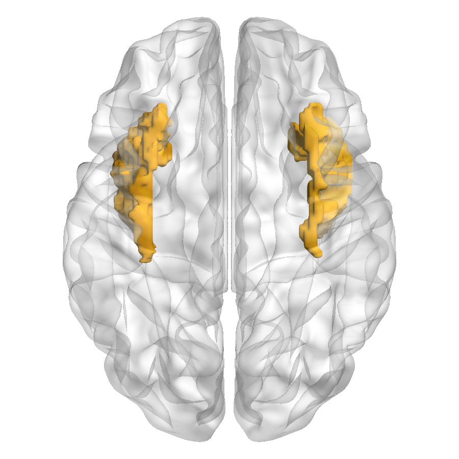

# Bilateral insula ROIs from AAL

[Tutorial index](index.md) · [Previous lesson](06_Statistical_Volume_to_Surface.md)

Draw the left and right insula from the bundled historical AAL label atlas, viewed from above through a transparent surface. This exercise uses discrete atlas regions, not ROIs generated by thresholding the statistical map from the preceding lesson.

## Select the atlas and surface

Use `resources/atlases/AAL90/aal.nii` as **Volume / Atlas**. The exact historical file assigns **29 = Insula L** and **30 = Insula R**; its documented dimensions are 181 × 217 × 181 with 1 mm voxels. SHA-256: `2926fcc98efc709f77c8cca2f9c1d797eba3e9a1b222a8e0cfa70ab131394c80`. These IDs must not be carried over to AAL3v2 or another atlas without checking its definitions.

For context, use the documented MATLAB smoothed ICBM152 surface or Python original ICBM152 surface, as in lesson 06. Retain **Prof. Alan C. Evans (MNI)** surface credit and the [existing AAL attribution](../../en/Resource_Attribution.md). The application does not register the atlas and surface.

## Draw only the bilateral insula

1. Clear prior Surface Map, Nodes and Edges; replace the earlier statistical volume with `aal.nii`. Add the surface, then **Validate and Load**.
2. Choose **Layout → Single View**, **View Direction → Superior (Axial)**, and **Surface Opacity `0.3`**.
3. In **Volume / ROI** (Python: **Volume**), enable **Display Volume** and choose **ROIs (Atlas / Statistical)**.
4. Choose **Threshold Mode → None** for these integer labels. Clear an unintended cluster-size filter left from a statistical example; do not use P Value on a label atlas.
5. Turn **Draw All ROIs** off and enter **ROI Selection `29,30`**. Choose **ROI Color Mode → Label Index** and **ROI Palette → hsv**. Click the shared **Apply**.



*Existing Python Desktop illustration with the original surface, opacity 0.3 and historical AAL IDs 29/30. Neighboring IDs have similar gold hues in this palette; color similarity does not mean the two regions have identical labels. *

Expect two deep bilateral ROI meshes, not every atlas region. **Draw All ROIs** disables ROI Selection; turn it off before editing the ID list. On a single-hemisphere surface, corresponding-side geometry is displayed rather than relabelling the atlas as a bilateral surface.

## Choose categorical colors

Label Index uses the selected **ROI Palette** to assign categorical colors. It is not the continuous scalar-map colorbar or the four-target continuous color editor. Optionally enable **Show ROI Legend** (MATLAB: **Show ROI ID Legend**) to identify region IDs.

For distinct left/right colors, choose **Custom** and supply one `ROI_ID R G B` row per selected region:

```text
29 0.92 0.22 0.18
30 0.16 0.42 0.95
```

Missing or duplicate ID rows must be corrected rather than interpreted as a fallback anatomical color. RGB components lie in [0,1]. Custom colors change display only, not the source atlas IDs.


*Existing MATLAB Desktop illustration using the smoothed surface, opacity 0.15, custom red/blue colors, Gaussian kernel 3 and an ID legend. It is an alternative configuration, not the same opacity/palette as the Python image above. Legend placement and limits can differ by edition.*

## Adjust display smoothing

None, Box or Gaussian smoothing affects rendered ROI geometry, not the stored atlas or true label definition. Kernel `1` leaves it unsmoothed; larger kernels can soften voxel-scale facets but may change displayed shape. Use None when precise voxel geometry matters. MATLAB's active smoothing operations can require Image Processing Toolbox; if unavailable, use None or kernel 1. Python uses its numerical/VTK dependencies without MATLAB toolboxes.

Do not infer anatomical accuracy from smoothness. Smoothing, opacity and the top-view camera can conceal boundaries or small components; examine the selected IDs and original atlas independently.

## Distinguish statistical ROIs and Inspect

If a supported statistical image is selected instead, Value/Cluster/P Value modes can form connected components after filtering. In **ROI + P Value**, Cluster Size is applied before component IDs are assigned. Size is in voxels and Voxel Connectivity can be 6, 18 or 26. This is an uncorrected display filter, not corrected cluster inference; changing it can change component IDs. Those generated IDs are not anatomical AAL labels and must not be interpreted as Insula L/R simply because an ID equals 29/30.

**Inspect does not select these ROI meshes.** For dual-atlas lookup, follow the [surface vertex-map lesson](05_Vertex_Maps_Boundaries_and_Inspect.md) and pick a rendered surface vertex. Inspect assumes the lookup tables' MNI frame and performs no registration or affine transformation.

## Save and check

After Apply, confirm the exact atlas, IDs `29,30`, top view, opacity and palette/legend. Save a same-edition Scene and review replay using [Scene instructions](03_Scenes_and_Presets.md). Export only after the intended ROI configuration renders; preserve the figure's provenance record and inspect metadata before sharing.

Atlas reference: Tzourio-Mazoyer et al. (2002). Automated anatomical labeling of activations in SPM using a macroscopic anatomical parcellation of the MNI MRI single-subject brain. *NeuroImage* 15:273–289. This citation does not make every later AAL version's IDs interchangeable.

Continue with [Multi view layouts and figure export](08_Layouts_and_Figure_Export.md).

For AAL90 auxiliary inputs, `resources/atlases/AAL90/` is relative to the repository/MATLAB archive root. In the installed Python/Docker resource library, choose `atlases/AAL90/`.
