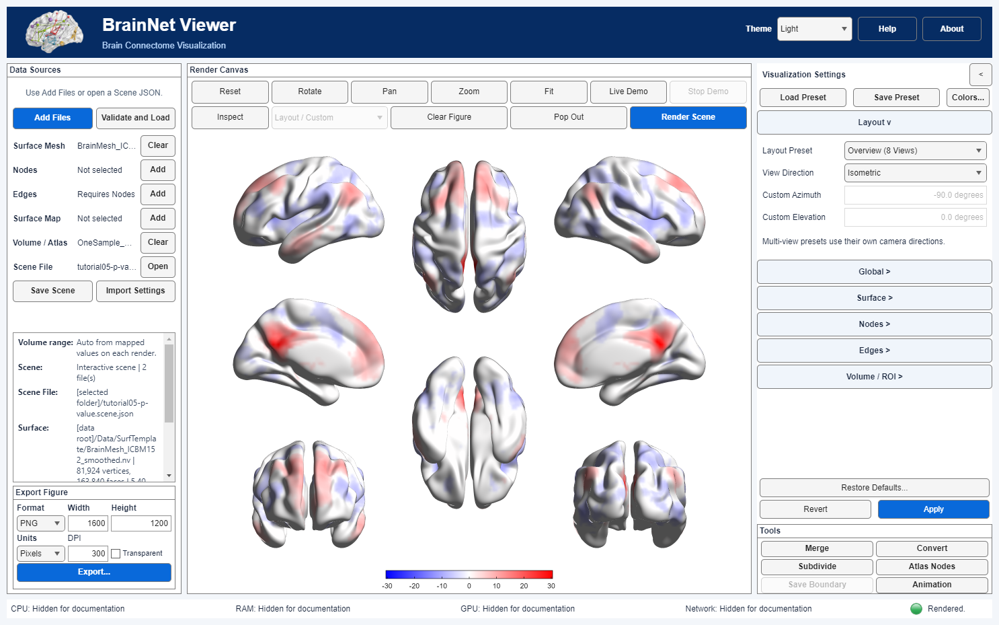
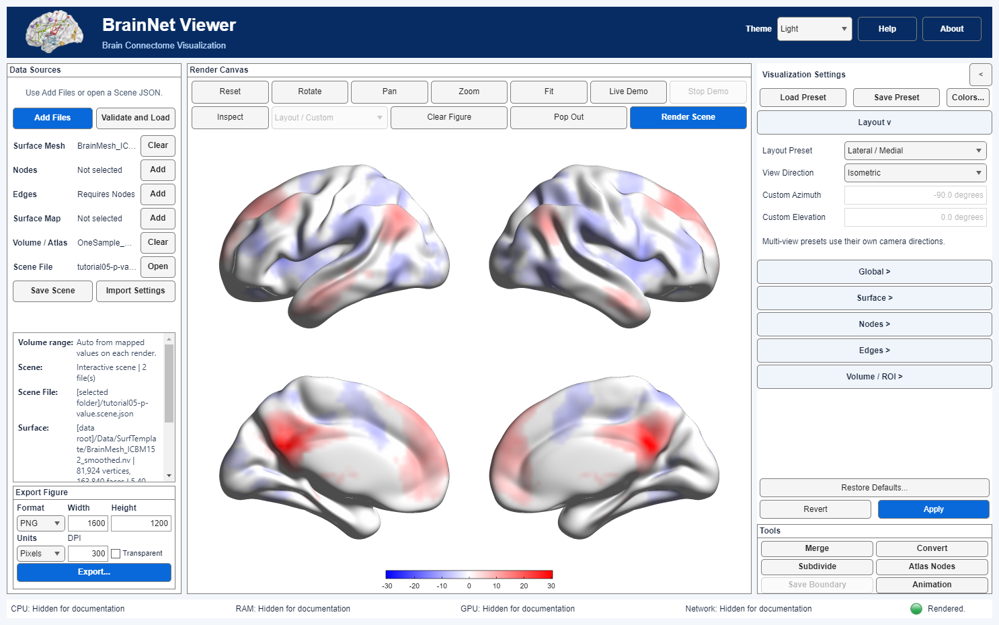
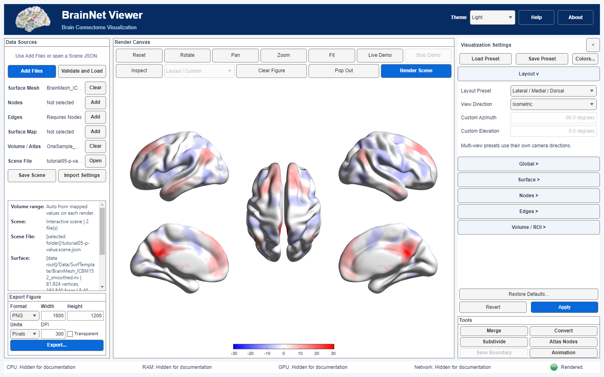

# Multi view layouts and figure export

[Tutorial index](index.md) · [Previous lesson](07_AAL_Insula_ROIs.md)

Choose complementary views of one real dataset, then save a figure at explicit pixel or physical dimensions. The exported figure contains the rendered scientific scene, not a screenshot of the entire application. View choice, output size and DPI do not change the underlying statistical inference.

## Keep the scientific settings fixed

Start with the [real PCC volume lesson](06_Statistical_Volume_to_Surface.md), using its documented surface and `Data/Tutorials/OneSample_ROI11_NC.nii`. Keep threshold, mapping algorithm, sign handling, surface opacity and color limits fixed while comparing layouts. Select a layout and click **Apply** to commit and render directly.

The gallery below reuses the **MATLAB Desktop** example: smoothed ICBM152, algorithm **5**, **P=0.001**, surface opacity **1** and a blue-white-red signed T scale. It is not the Python lesson's original surface/algorithm 2/P=0.05 example, and is not a new candidate capture. All panes display the same dataset rather than different subjects.

## Choose a layout

| Layout | Views and purpose |
| --- | --- |
| Single View | One adjustable direction, useful for close inspection |
| Overview | Eight views for a safely separable hemisphere pair; six whole-surface views for an inseparable mesh |
| Lateral / Medial | Four lateral and medial hemisphere views |
| Lateral / Medial / Ventral | Six views including two inferior views |
| Lateral / Medial / Dorsal | Five views including a central superior whole-brain view |

A hemisphere-splitting layout needs compatible geometry. Do not force a continuous/ambiguous surface into two halves or infer eligibility from a filename alone. **View Direction** is used for Single View; multi-view presets provide their own cameras and disable that choice. Old illustrations show their original UI state, not every current control's enabled state.

### Overview

*Existing MATLAB Desktop illustration on the separable smoothed ICBM152 mesh. Eight complementary views summarize the map, but may become too small for a narrow publication column.*

### Lateral and medial

*Existing MATLAB Desktop illustration. Four views make lateral and medial details larger at the same overall figure size; this is the TIFF exercise below.*

### Lateral medial and ventral

*Existing MATLAB Desktop illustration. The two inferior views are rotated outward. Check their details and separation from the bottom colorbar at the intended output size.*

### Lateral medial and dorsal

*Existing MATLAB Desktop illustration. The central superior view supplements the four hemisphere views. Framing, margins and colorbar placement are renderer/layout-specific; these images do not establish pixel-identical Python results.*

## Adjust cameras and keys

Within a layout, initial framing uses consistent scale. Use **Rotate**, **Pan** or **Zoom** on the intended subplot; it does not synchronously alter every view. **Fit** frames visible geometry and **Reset** restores layout cameras. Camera changes affect appearance, not coordinates. Save a Scene rather than a display preset if you need compatible camera replay.

Keep the signed surface colorbar visible for this statistical map and review its title, ticks and ends for overlap. Additional Node/Edge bars or a categorical ROI legend have different meanings and consume space; add them only when the corresponding data are present. Check Single, Ventral, Dorsal and Overview separately rather than assuming a placement suited to one layout suits all. The historical gallery's bottom strip is not a requirement to put every current bar at an identical pixel position.

## Export a TIFF in pixels

1. Return to **Lateral / Medial**, Apply, and confirm the current brain and colorbar are complete.
2. In **Export Figure** below Data Sources, select **TIFF**, **Units → Pixels**, width **1800**, height **1350**, **DPI 300**, and **Transparent off**.
3. Click **Export...** or **Export Figure** and choose a new writable `.tif` destination. Close the successful-save message and review the actual output.

*Existing MATLAB Desktop illustration with TIFF/1800×1350/300 selected. This depicts controls and the historical real-data exercise; it is not a newly generated Python TIFF or a new export test.*

At 300 pixels per inch, 1800×1350 pixels corresponds to a nominal **6×4.5 inches** placement. Confirm dimensions and DPI in the saved file and the downstream layout tool; metadata alone does not prove printed size. A larger output cannot recover anatomical detail absent from the source volume.

## Choose physical size instead

Both compact panels offer Pixels, millimetres, centimetres, inches and points. MATLAB uses menu spellings **Millimeters/Centimeters**; Python uses **Millimetres/Centimetres**. For another exercise, set width **160**, height **120**, units **Millimetres/Millimeters**, and **200 DPI**. This corresponds to approximately **1260×945 pixels**, subject to pixel rounding. Select a new output name and verify effective dimensions rather than assuming the unit switch preserved your intended size.

Pixels = inches × DPI; millimetres = inches × 25.4, and one point = 1/72 inch. Width/height in Pixels determine raster dimensions. DPI describes density/placement, not statistical precision. Read annotation size at the final placement scale, not just in a large interactive window.

## Select format and transparency

| Format | Practical interpretation |
| --- | --- |
| PNG | Lossless raster output; useful for supported transparent overlays |
| TIFF | Raster publication workflow; check the edition's supported alpha route if requesting transparency |
| JPEG / BMP | Opaque output; JPEG compression can affect fine detail |
| PDF / SVG | Page/graphics containers; not a promise of editable vector brain geometry |

The compact panels use **Transparent**, not separate Content/Background selectors. Light/Dark changes interface styling, not the scientific export background. With Transparent off, inspect the rendered background and applied export preferences rather than assuming white.

**Python Desktop:** opaque PDF/SVG combines raster brain geometry with vector annotations; SVG glyphs can be outlines rather than editable text. Transparent PDF/SVG embeds the complete RGBA scene, including annotations, as an image. Its physical page dimensions follow pixels divided by DPI. **MATLAB Desktop:** content follows the supported MATLAB export route; complex 3-D graphics can be rasterized. Inspect the actual file in your downstream tool before claiming vector editability.

For a simple transparent exercise, choose PNG, **800×600 Pixels**, **200 DPI** and Transparent on. Save to a new path and inspect real alpha in a viewer that supports it; a white viewer background alone cannot establish absence of transparency. JPEG/BMP cannot carry transparent output. This is an exercise instruction, not a claim that every format/platform has passed acceptance.

## Review the result and preserve provenance

Keep `<image filename>.provenance.json` with the exported image. Review effective dimensions, settings, cameras, versions and input/output identities; verify the image hash if checking a copied pair. MATLAB records can contain local paths; Python figure records omit absolute input paths but may retain filenames and titles. Neither policy guarantees complete anonymization. Review metadata before sharing, and do not confuse figure sidecars with metadata written by separate data tools.

After save or cancel, confirm that the interactive window, camera framing, colorbar/annotation size and display DPI remain appropriate. If export reports an error, retain the complete message and review the restored canvas before retrying. Do not manufacture permission failures or overwrite unrelated files as a test. A rendered screen and a saved file provide different evidence; check both.

Use a fresh destination when an existing image or sidecar must be preserved. Export requires a current render, not merely loaded files. Check all brain views, title, colorbar ticks, labels, dimensions and transparency at the final output size. If cropped, adjust Fit/layout/output aspect ratio and export again; do not infer that valid source coordinates are wrong solely from framing.

Retain the PCC study citation and Evans/MNI surface credit from [lesson 06](06_Statistical_Volume_to_Surface.md). The example remains a one-sample connectivity T map with an uncorrected voxelwise threshold, not a disease-group contrast. Provenance identifies files/configuration; it does not validate registration, statistical inference, a digital signature or identical pixels across graphics environments.

Continue with [Custom colors and display presets](09_Custom_Colors_and_Presets.md).
