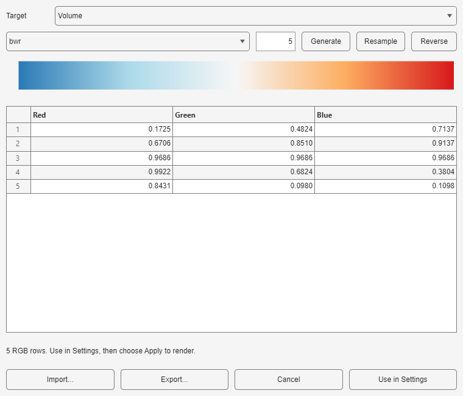
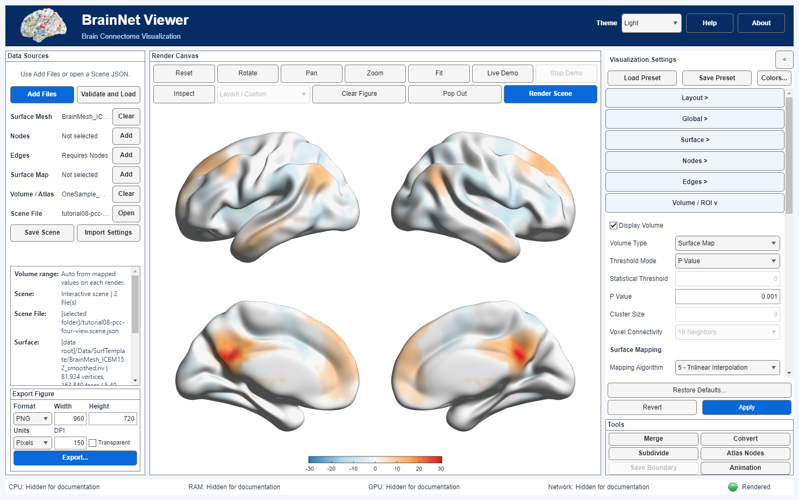

# Custom colors and display presets

[Tutorial index](index.md) · [Previous lesson](08_Layouts_and_Figure_Export.md) · [Scene basics](03_Scenes_and_Presets.md)

Edit a Volume palette on the real PCC map, apply it and save an appearance preset for same-edition reuse. A palette controls colors, a preset stores display settings, and a Scene records the input-plus-display combination. None performs registration or changes the original statistical analysis.

## Prepare the real map

Complete the [PCC mapping lesson](06_Statistical_Volume_to_Surface.md) using your documented surface and `Data/Tutorials/OneSample_ROI11_NC.nii`. Choose four lateral/medial views, Surface Opacity 1, Positive & Negative display and a visible surface colorbar. Record the P value, mapping algorithm and color limits before editing colors; leave them unchanged for this exercise.

The MATLAB images below retain the older smoothed ICBM152/algorithm 5/P=0.001 configuration. The Python starting lesson uses original ICBM152/algorithm 2/P=0.05. These images are not an identical-parameter or new-candidate comparison. Retain the PCC study citation and Evans/MNI surface credit from lesson 06.

## Import a five row palette

Download or locate the tutorial's [three-column RGB text file](../assets/pcc-diverging.rgb.txt). It contains these exact project-authored values, reused from the existing teaching palette:

```text
0.1725 0.4824 0.7137
0.6706 0.8510 0.9137
0.9686 0.9686 0.9686
0.9922 0.6824 0.3804
0.8431 0.0980 0.1098
```

1. Click **Colors…** in Visualization Settings and choose **Target → Volume**. A Volume surface map consumes this palette, not the Surface vertex-map palette.
2. Click **Import…**, select the RGB text file and inspect all five rows and the blue–near-white–red preview. Components must be finite and in [0,1]. This preview describes colors, not thresholds.
3. Click **Use in Settings** to stage the colors, then click the shared **Apply** to commit and render. Exporting a palette alone does not apply it to the figure.



*Existing MATLAB Desktop illustration. The numeric rows match the shared text file; the original exercise imported a MATLAB JSON object. It is not a new Python editor capture. The named Preset dropdown is a source for Generate, not proof that an imported numeric table has that name.*

Positive & Negative uses the two halves of one palette around its midpoint. The underlying sampled T values, P threshold and algorithm do not change. Check the resulting signed limits and null/background color; a pale color or a smooth preview is not evidence of significance, perceptual uniformity or accessibility.



*Existing MATLAB Desktop illustration at P=0.001, algorithm 5, with the five-row palette. Color changes do not make this one-sample connectivity map a disease-group contrast.*

## Use the correct target and file format

The editor has **Surface**, **Nodes**, **Edges** and **Volume** targets. A selected color mode must consume that target's palette. Within-module edge colors use the Nodes module palette; fixed threshold colors and ROI Custom ID colors are separate. Changing the Volume palette does not recolor an independently loaded Surface vertex map.

Use Generate to build a named palette with the selected count, Resample to change an existing table's resolution, or Reverse to invert row order. Review the resulting table before Use in Settings/Apply. Common named choices include Viridis, Plasma, Inferno, Magma and Cividis. A palette name alone is not an accessibility assessment.

| Edition | Palette file handling |
| --- | --- |
| MATLAB Desktop | RGB TXT or its supported JSON object with `kind: brainnet-colormap`, schema `1.0` and `colors` |
| Python Desktop | Whitespace RGB text, CSV or supported JSON arrays/objects with `rgb` or `colors`; JSON export writes an RGB array |

The shared text example avoids assuming arbitrary JSON interchange. Preserve row order and follow the edition's validation/size restrictions. **Export…** in the editor writes a palette, not a scientific figure or a full preset. Use a new filename when an existing file must be preserved.

Cancel or closing the editor discards that editor session's unapplied changes; it does not necessarily remove settings staged earlier. **Revert** in the main settings panel discards pending panel edits. Apply commits settings and renders. Review the main controls if unsure which state is active.

## Save and replay a preset

1. After Apply, inspect the custom colors and unchanged data/settings, then choose **Save Preset** and a new writable `pcc-colors.preset.json` destination.
2. Temporarily change only the Volume colormap to named `bwr` and Apply, retaining the same inputs.
3. Choose **Load Preset** and open the file saved by this edition. Review compatibility information and all data-dependent thresholds, ranges and IDs before rendering.

**MATLAB Desktop:** Save Preset captures applied settings, not pending edits. Loading retains input references/export preferences but clears the previous render/camera after review. Follow the current UI's rendering entry, using Render Scene for an explicit redraw.

**Python Desktop:** Save Preset can capture current panel edits not yet applied to the figure. Loading normalizes and stages controls; select Apply to commit and render. Applying before save avoids confusion, but does not change those save semantics.

Confirm that the custom rows and four-view configuration return and that the input paths still identify the intended mesh and volume. Do not require identical pixels across graphics environments. A preset may include more than the palette, such as layout, thresholds and volume controls; it is not safe to apply blindly to another atlas/statistical image.

## Keep presets separate from Scenes

A preset does not package inputs, the interactive camera or the full export session. Use [Save Scene](03_Scenes_and_Presets.md) for that combination and preserve the edition's referenced root/files or JSON/assets bundle. The shared JSON extension does not guarantee cross-edition Scene or preset compatibility.

This lesson asks you to save your own same-edition preset; it does not distribute a prebuilt Scene or promise that the historical MATLAB preset loads unchanged in Python. Review names/titles and metadata before sharing either file. Palette editing is a display operation, not a new statistical computation.

Next: [command-line replay of your own saved Scene](10_Command_Line_Scene_Replay.md).
