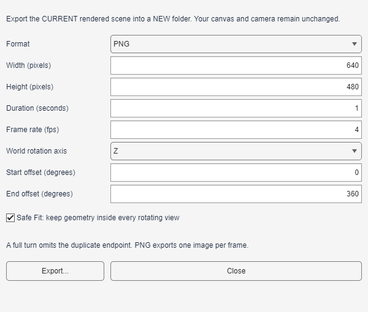
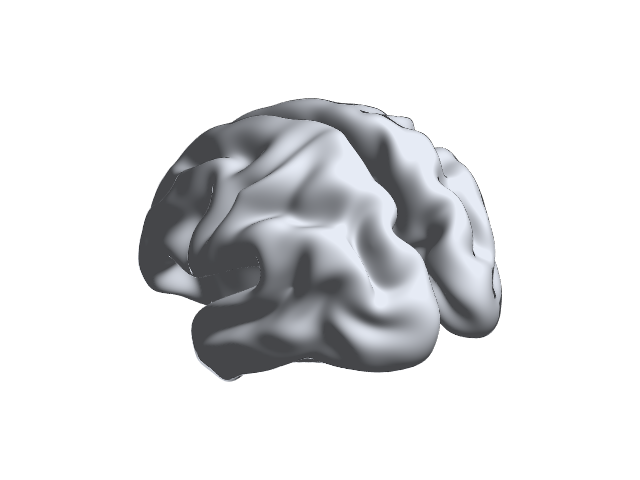
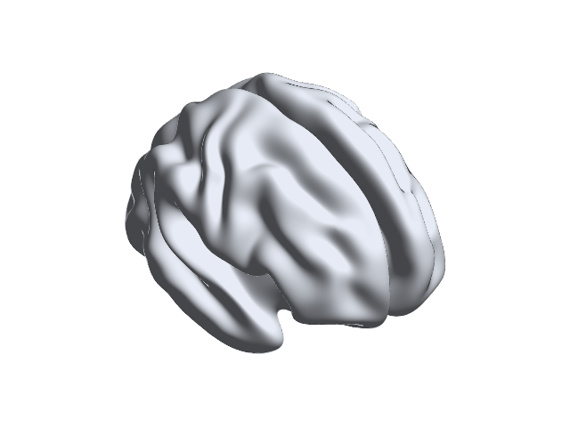

# Camera animation of a static brain scene

Export a short orbit around a real ICBM152 surface, first as four PNG frames and then, if needed, as a smoother sequence or video. This rotates the camera around one static dataset. It does not depict changing brain activity, dynamic connectivity or anatomical deformation.

## Prepare the rendered scene

Load `Data/SurfTemplate/BrainMesh_ICBM152_smoothed.nv` from your installed library. In Python, this path is relative to the installed `resources` folder. Credit Prof. Alan C. Evans, MNI, for the source surface.

Choose **Single View**, **Uniform** surface color, **Opacity 1** and **Boundary None**. Remove unrelated node, edge, map or volume inputs for this first exercise. Apply the settings and review the rendered surface. Use Rotate to choose the starting view if needed; the orbit offsets are relative to that camera, not absolute anatomical directions.

Stop Live Demo if running. Ordinary Rotate/Pan/Zoom manipulates the selected subplot, whereas exported animation orbits the views in its independent rendering copy. Use one view first so the framing is easy to inspect.

## Configure a four-frame PNG check

**MATLAB Desktop:** open **Tools → Export Animation...**. **Python Desktop:** select **Animation**. Both require an applied, rendered Scene; choosing files alone is insufficient.

| Setting | First exercise | Purpose |
| --- | --- | --- |
| Format | PNG frames (`png` in Python) | Lossless images without a video encoder |
| Width / Height | 640 / 480 pixels | Small inspection output |
| Duration / Frame Rate | 1 second / 4 fps | Four deliberately coarse views |
| World Axis | Z (`z` in Python) | Orbit around the world Z axis |
| Start / End Angle | 0° / 360° | One turn relative to the initial camera |
| Safe Fit | Enabled | Include geometry throughout the orbit |

A full turn omits the duplicate endpoint, so these four frames correspond to offsets 0°, 90°, 180° and 270°. Frame rate controls playback timing, not the speed of offline rendering. This four-frame exercise is not a recommended presentation rate.

Existing MATLAB illustration at 640 × 480, 1 second and 4 fps. Python has corresponding controls but different labels, including World Axis and Start/End Angle. This image is not a Python screenshot or acceptance of the current candidate.

Select MATLAB **Export...** or Python **Export to New Folder...**. Under an existing writable parent directory, enter a new folder name such as `icbm-orbit-check`. The destination is a bundle directory, not a single PNG filename. Existing destinations cannot be overwritten; choose another name for subsequent runs.

## Inspect frames and the main canvas

The PNG bundle contains `frame-000001.png` through `frame-000004.png`, `preview.png` and `provenance.json`. Open all four frames and check image dimensions, complete brain geometry, lighting and any labels. The four views are camera positions, not four acquired neuroimaging time points.

Existing MATLAB outputs from the smoothed ICBM152 exercise, showing two opposite points in the four-frame orbit. They are historical illustrations, not newly exported Python or cross-platform comparison results. Starting views, shading and output pixels may differ between graphics environments.

Compare the main canvas with its pre-export view. The export uses an isolated rendering copy and must not move its cameras. Safe Fit changes the export copy's framing, so the exported brain can be smaller than the interactive brain. Turning it off retains the starting framing but can crop other angles; review every frame before using the result.

Inspect provenance for the plan, effective frame count, input identity and software information. Source data are referenced, not copied into the animation bundle. Review paths, titles and other metadata before sharing; image-export privacy behavior is not a blanket guarantee for animation records.

## Export a smoother sequence or video

After reviewing the small check, select a new destination and try **960 × 720 pixels, 5 seconds, 24 fps**, keeping the Z-axis turn and Safe Fit. This requests 120 frames, not real-time export at 24 fps.

| Edition | Video support |
| --- | --- |
| MATLAB Desktop | MP4 depends on the available MPEG-4 VideoWriter profile; AVI depends on supported profiles. Use PNG when the desired profile is unavailable. |
| Python Desktop | MP4 uses H.264 and AVI uses Motion JPEG through the available FFmpeg/imageio-ffmpeg runtime. Use PNG if the encoder is unavailable. |

Video bundles contain `movie.mp4` or `movie.avi`, plus `preview.png` and `provenance.json`, rather than the numbered PNG sequence. Compressed video pixels are not identical to the original PNG pixels. Pre-encoding frame hashes do not identify the decoded lossy frames; the completed video has its own file identity. Playback looping depends on the external player.

The size/timing limits are 128–3840 pixels per dimension, 1–60 fps, 2–1800 frames, at most 120 requested seconds and one billion total frame-pixels. Video dimensions must be even. The orbit must be nonzero and no greater than 360° in magnitude. Effective duration is the integer frame count divided by fps. No audio, transparent movie or GPU video encoding is promised.

## Cancellation and troubleshooting

Use the export's cancel control if necessary. MATLAB offers **Cancel Export**; Python offers **Cancel** in its progress dialog. Cancellation can wait for the current frame or codec operation. A cancelled or failed export should not publish a partial completed bundle, and the main canvas must retain its camera. Do not delete an existing output or unrelated files to force a retry.

If export is disabled, Apply and render first. If the brain is cropped, enable Safe Fit and inspect the full orbit; labels can extend beyond the fitted geometry. If an encoder is unavailable, use PNG rather than changing the scientific inputs. If the result differs from the starting display, check applied settings and export framing, not the interface's Light/Dark theme.

These steps teach the workflow, not a new codec or installed-package acceptance test. Preserve the actual error and environment when reporting a failure; successful PNG export does not establish MP4/AVI support on another system.

Next: [performance and reproducible figures](13_Performance_and_Reproducibility.md).
