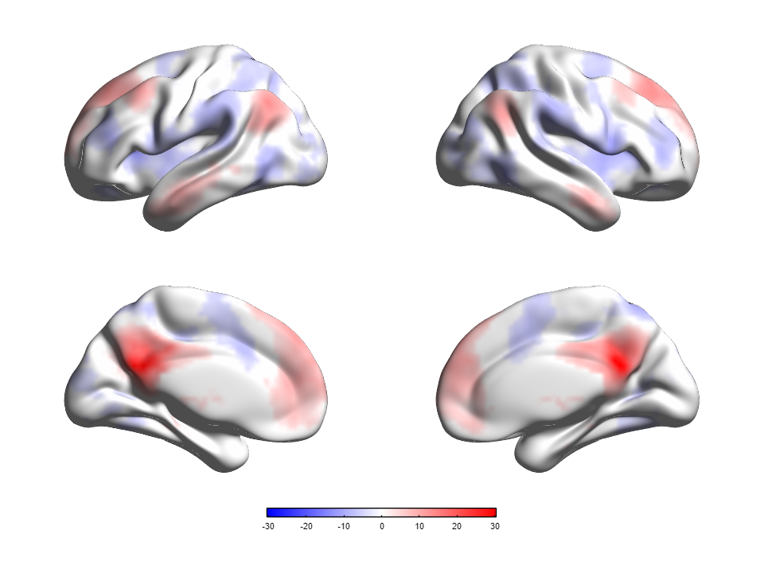

# 05 · 真实统计体图映射到曲面

[English](../en/05_Volume_to_Surface_Mapping.md) · [教程目录](index.md) · [体图手册](../../manual/zh-CN/M09_Volume_Mapping.md)

本教程使用真实单样本功能连接T图，位于标准MNI空间。数据来自Xia等（2014），*Journal of Alzheimer's Disease* **39**:527–543中的PCC亚区种子点分析；它**不是**AD与对照组的组间差异图。复用前请阅读[确切文件来源与解释说明](Resource_Attribution.md)。

使用[`BrainMesh_ICBM152_smoothed.nv`](../../../src/matlab/BrainNetViewer/Data/SurfTemplate/BrainMesh_ICBM152_smoothed.nv)作为**Surface Mesh**，[`OneSample_ROI11_NC.nii`](../../../src/matlab/BrainNetViewer/Data/Tutorials/OneSample_ROI11_NC.nii)作为**Volume / Atlas**。NIfTI SHA-256为`e27d9eca7e20f31ed090e410fdb5b4a409565c2fafc3bc86dff21277e58aad5f`，头文件描述`REST{T_[37.0]}`；图像61×73×61体素、3 mm，T统计量自由度37。曲面来源须另署名Prof. Alan C. Evans（MNI），不可与研究论文作者混同。

| 控件 | 教学取值 | 理由 |
|---|---|---|
| Layout → Preset | Lateral / Medial（四视图） | 比较双半球外侧面与内侧面。 |
| Surface → Opacity / Show Surface Colorbar | 1 / 开启（新默认） | 不透明解剖背景，并显示连续映射T值色条。 |
| Volume → Display Volume / Volume Type | 开启 / Surface Map | 将NIfTI取样到曲面。 |
| Volume → Threshold Mode / P Value | P Value / `0.001` | 由REST头中的T(37)推导**双侧、未校正逐体素**阈值。 |
| Volume → Mapping Algorithm | 5 · Trilinear Interpolation | 在体空间进行更平滑的取样；不同于算法2的曲面邻点平均。 |
| Volume → Display Values / Colormap | Positive & Negative / Blue-White-Red | 分别显示正负号；颜色为采样T值，不是P值。 |

## 操作步骤

### Step 01

在项目根目录执行`app = BrainNetViewer;`。在**Data Sources → Add Files**中，将平滑ICBM152 `.nv`选作**Surface Mesh**，再将`.nii`选作**Volume / Atlas**，点击**Validate and Load**。核对Scene摘要有两份项目数据文件。可读取不代表已配准：映射使用NIfTI仿射矩阵，但不会执行图像配准；解剖解释前应核对两份标准MNI教学文件的仿射对齐。

### Step 02

在**Visualization Settings → Layout**选**Lateral / Medial**（四视图）；在**Surface**把**Opacity**设为`1`。展开**Volume / ROI**，开启**Display Volume**，选**Surface Map**、**P Value**并输入`0.001`；**Mapping Algorithm**选**5 - Trilinear Interpolation**，**Display Values**选**Positive & Negative**，**Colormap**选**Blue-White-Red**，保留**Adjust for Null**。点击右侧共用的**Apply**提交并绘图。R2025a解析器以df=37算出双侧`|T| ≥ 3.5737`；不执行FWE/FDR校正。算法5对**已阈值化**体图插值，边缘数值可能降低或混入零/背景，显示顶点不是逐体素P值检验。算法2则把最近邻取样与曲面邻接顶点平均，可能跨网格相连的解剖区域模糊。需要精确体素T值取样时改用算法1。

*当前构建的英文四视图完整窗体图；文档截图隐私模式仅在显示层隐藏本机路径。体图来源：Xia等（2014）的NIfTI统计图；曲面来源：Prof. Alan C. Evans（MNI）。红/蓝代表插值T统计量的正负号，不是疾病组间差异。*

*960×720当前构建四视图导出图。三线性插值在体素阈值化之后进行；观感更平滑不改变名义逐体素P阈值，也不提供多重比较校正。*

### Step 03

使用**Save Scene**保存新的`.scene.json`，在新App实例中重新打开并**Validate and Load**/**Render Scene**。专项重放成功恢复四视图、算法5及`P Value = 0.001`，渲染并导出PNG，侧车记录两份输入。Scene JSON只引用文件，不内嵌2.17 MB NIfTI；转移Scene时须同时带上确切数据，分享前检查JSON/PNG侧车中是否有本机私有路径。

## 常见问题与解释边界

- **P Value**拒绝某文件时，核查NIfTI统计描述或intent以及自由度；仅凭文件名/数值范围不足以推断统计量。历史`zFCS.nii`的描述冲突，原样不能用于P值换算。
- 颜色很淡或无色不代表科学意义上的“无效应”；阈值、曲面取样、白/空值颜色和对称正负色轴都会影响观感。
- 三线性插值在体素之间取样已阈值化体图；边缘值可能降低，最近体素低于阈值的位置也可能因相邻体素而显示非零值。算法2则对网格邻点求平均。显示顶点**不是**独立的校正后显著性检验；需要精确最近邻T值时选算法1。
- 外观合理的渲染不等于独立复核解剖配准及原论文统计流程。发表前仍须核对源坐标约定和分析所需的推断方法。
