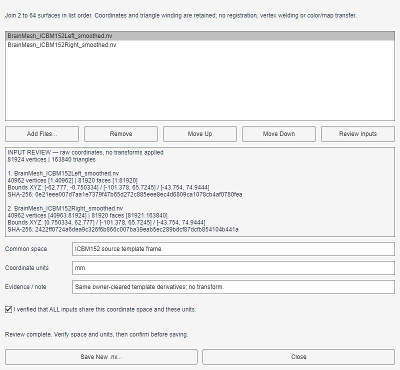

# 11 · 合并曲面与保存边界掩膜

[English](../en/11_Merge_Surfaces_and_Save_Boundaries.md) · [教程目录](index.md) · [曲面工具](../../manual/zh-CN/M13_Surface_Tools.md) · [边界语义](../../documentation/Surface_Boundaries.zh-CN.md)

本教程包含**两个独立流程**：先合并ICBM152平滑版左右半球衍生曲面；再在**原配完整平滑曲面**上导出AAL标签边界，而不是把AAL图直接套到新合并文件上。曲面及衍生品保留Prof. Alan C. Evans（MNI）署名；AAL引用Tzourio-Mazoyer等，*NeuroImage* 15:273–289（2002）。本地AAL确切版本和投影方法仍须核对。

## 步骤 01 · 审核左右半球输入

打开 **Tools → Merge Surfaces...**，点击 **Add Files...**，依次选择`Data/SurfTemplate/BrainMesh_ICBM152Left_smoothed.nv`与`Data/SurfTemplate/BrainMesh_ICBM152Right_smoothed.nv`，自动显示复核信息。两侧各有 **40,962个顶点**，合并后共 **81,924个顶点／163,840个三角面**。保存前检查两个哈希、坐标范围和成分索引范围。这两份文件来自同一ICBM152模板；不能因其他曲面名称相似便推断它们处于同一空间。

*MATLAB输入检查窗口。截图显示文件名，实际检查与输出溯源仍记录完整路径。没有应用变换或配准。*

## 步骤 02 · 保存新的合并曲面

对于这组确切文件，可选填 **Space** `ICBM152 source template frame`、**Units** `mm`、**Note** `Same template derivatives; no transform.`；可全部留空，无需Verify勾选。点 **Save New .nv...**，选取一个**新的**`.nv`路径。声明记录模板来源判断，不等于独立验证了配准。工具按顺序拼接坐标、偏移右半球面片索引，并在保存后读回检查；已有文件不会被覆盖。若要查看输出，须再通过 **Data Sources → Surface Mesh** 显式读取；保存不会替换当前Scene。截图为控件简化前的界面，几何及复核信息不变。

这组文件合并后的**顶点坐标集合**与原配完整平滑曲面一致，但**顶点顺序不同**。合并不焊接顶点，也不迁移逐顶点标签、颜色或映射。不要仅因两者都是81,924顶点就把`icbm_vertex_AAL_label.txt`直接套到新合并`.nv`：它按原完整曲面的顶点顺序制作，必须另行检查并重排索引。

## 步骤 03 · 在原配曲面上保存边界

回到主App，以`Data/SurfTemplate/BrainMesh_ICBM152_smoothed.nv`作为 **Surface Mesh**、`resources/atlases/AAL90/icbm_vertex_AAL_label.txt`作为 **Surface Map**。这是[教程04核验过的原配组合](04_Vertex_Maps_and_Boundaries.md)，**不是**新合并文件。点 **Validate and Load**；在 **Visualization Settings → Surface** 中设 **Scalar Map**、**Opacity 1**、**Colormap Jet**、**Color Limits `0 90`**、**Boundary Automatic**、**Boundary Color black**；关闭 **Show Surface Colorbar**，因为脑区编号不是连续效应量。点底部共用 **Apply**，再选 **Tools → Save Surface Boundary...**，指定新的`.txt`文件名。

*教程04指定曲面和顶点图的MATLAB截图；图中不是新合并曲面。*

这组固定输入和设置应导出 **81,924个二值数**，其中 **11,942个边界顶点**。请使用新文件名，避免与已有输出冲突。输出附带溯源注释，分享前检查本机路径。边界掩膜绑定原顶点顺序；它不是脑区名称表，也不是连续几何等值线。保存不改变当前Scene。

## 核查与局限

- 输入顺序改变合并后顶点/面片索引范围；保存前用 **Move Up / Move Down** 调整并重新审核。
- 合并工具不会覆盖旧输出；应使用新文件名。
- 错序曲面套用AAL图可能看似合理却解剖位置错误；须核对原曲面和映射哈希，仅数量一致不够。
- Automatic边界标记网格上的类别转换，不是统计阈值、空间配准核验或历史AAL投影验证。
-
