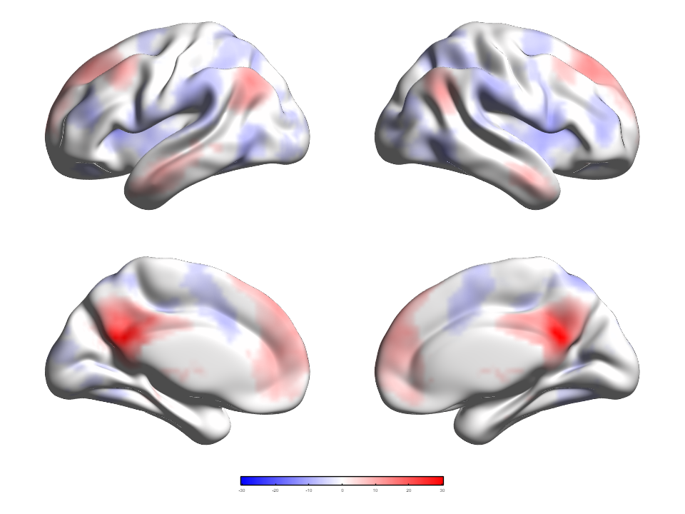

# 13 · 用真实数据评估性能与可复现性

[English](../en/13_Performance_and_Reproducibility.md) · [教程目录](index.md) · [命令行与溯源手册](../../manual/zh-CN/M14_Batch_Provenance.md) · [真实T图解释](05_Volume_to_Surface_Mapping.md)

本教程使用教程05、08中的PCC亚区单样本功能连接T图和ICBM152平滑曲面，说明如何分别测量绘图与映射用时。[计时记录](../assets/performance/tutorial13-real-pcc-r2025a-public.json)仅反映这组数据和硬件，不能直接预测其他环境中的性能。基准脚本未随教程提供。该T图**不是**阿尔茨海默病组与对照组的比较；分享图像时，请保留[数据引文](Resource_Attribution.md)及Prof. Alan C. Evans（MNI）的曲面署名。

## 步骤 01 · 固定输入与执行条件

使用附带的[四视图Scene](../assets/scenes/tutorial08-pcc-four-view.scene.json)，SHA-256 `7d0c9b11c734f8297235d000927d2fab28301176106683d729e2e20bba439ab0`；其曲面SHA-256为`aff1920baef51956971b8c1de068e8eee2d1279f21fc90452bcd0dba2794fdc5`，NIfTI SHA-256为`e27d9eca7e20f31ed090e410fdb5b4a409565c2fafc3bc86dff21277e58aad5f`。Scene采用**算法5（三线性）**及已保存的统计/显示配置。不能悄悄更换输入、阈值、布局或映射算法后继续对比数值。

本次环境为 **MATLAB R2025a Update 1 / Windows 64位**、AMD Ryzen Threadripper 3970X（32核、64逻辑处理器）、NVIDIA GeForce RTX 3080 Ti。完整渲染采用 **CPU后端、Publication Quality、960 × 720目标位置、四视图**。三次试验每次新建渲染器，几何缓存均未命中；计时**不含**数据读取和数值准备。MATLAB JIT/图形系统及操作系统缓存仍在同一进程中延续，因此不是三次独立MATLAB冷启动。CPU/GPU映射内核计时均在**预热调用后**进行。

*复用教程08真实数据配图，标识所测Scene；这不是性能图表，也不证明解剖配准或新增统计推断。*

## 步骤 02 · 复现测量方法

上述结果由MATLAB基准脚本取得。若要在源码检出环境中独立复现测量方法，先取得确切 Scene、曲面和 NIfTI，并核对上文 SHA-256。通过正常加载器读取；禁用几何缓存，分别在 CPU 上准备两次，记录坐标/映射值指纹与缓存键。每次新建渲染器，以 CPU、Publication Quality、960 × 720 完成三次绘图计时，排除读取、数值准备及文件导出。对算法 5 的**三线性体图到曲面映射内核**先预热，再对**相同输入**做三次 CPU 计时；仅当 GPU 可用时再做三次 GPU 计时。先核对 CPU/GPU 映射值，再比较中位数。记录 MATLAB 版本及 Update、系统、实际 CPU/GPU 型号、后端状态、缓存状态、各次用时与 GPU 失败原因；将报告与输入哈希、Scene 一起保存。GPU 不可用时，不能将其记为零秒。

基准脚本未随教程提供。复现这些测量时，需要使用相同输入和设置，并编写只计时相应阶段的脚本。

## 步骤 03 · 正确解读本机结果

随教程附带的JSON记录了上述设备的一次测量：

| 测量 | 本机示例 | 范围 |
|---|---:|---|
| 三次CPU全质量渲染 | 6.659、2.180、1.930秒；中位数 **2.180秒** | 每次新建渲染器；不含读取、准备及图像文件导出；首次启动开销可见。 |
| 预热后的三线性CPU映射 | 中位数 **0.0208秒** | 仅将这份真实NIfTI按算法5映射到81,924个曲面顶点。 |
| 预热后的三线性GPU映射 | 中位数 **0.00884秒** | 该RTX 3080 Ti上相同内核；仅此小样本的CPU/GPU中位数比 **2.35倍**。 |
| CPU–GPU映射值 | 最大绝对差 **0** | 只针对这组确切输入；不证明所有算法、GPU或图像一致。 |

GPU的2.35倍是**映射内核**的比值，**不是整幅图渲染速度的提升**。GPU路径只覆盖支持的映射运算；MATLAB图形创建/刷新、PNG或视频编码另有成本。CPU向量化不代表启动了MATLAB `parpool`，也不能说明64个逻辑处理器全部占满。其他设备上，GPU可能不可用，或因启动和传输开销反而更慢。不可把这次四视图测量当作普适BrainNet Viewer性能结论；论文实验应预先规定数据集、重复次数、硬件、区间估计和比较基线。

## 步骤 04 · 保存可复现图像

对同一Scene制作论文图时，按[教程08的`BrainNetRender`流程](08_Command_Line_and_Scene_Replay.md)明确指定`DataRoot`、`ComputeBackend="cpu"`和`PerformanceMode="quality"`，并一起保存Scene JSON、输入哈希、输出侧车、MATLAB/渲染器版本及导出尺寸。样例报告记录了准备缓存键和数值几何/映射值指纹，两次禁用缓存的准备结果完全一致。哈希证明**文件及计算值身份**，不证明解剖配准或统计有效性。不同MATLAB版本、驱动、操作系统、温度及后台负载可能改变像素和用时。基准报告含硬件标签和哈希，不含本机绝对路径；分享图片侧车前仍须逐项审查。

## 失败检查

- **输入丢失或改变：**停止并恢复确切的数据根目录，不能绕过哈希不一致。
- **GPU不可用：**使用CPU并记录原因。`ComputeBackend="gpu"`只对具体运算有效，不保证整体GPU渲染。
- **时间异常：**控制后台负载后复跑，记录预热和缓存状态，区分数值准备、绘图及文件导出，而非一律称为“渲染时间”。
- **图像不同：**先核对Scene/输入哈希、设置、相机、质量/后端及数值指纹，再比较栅格像素。
