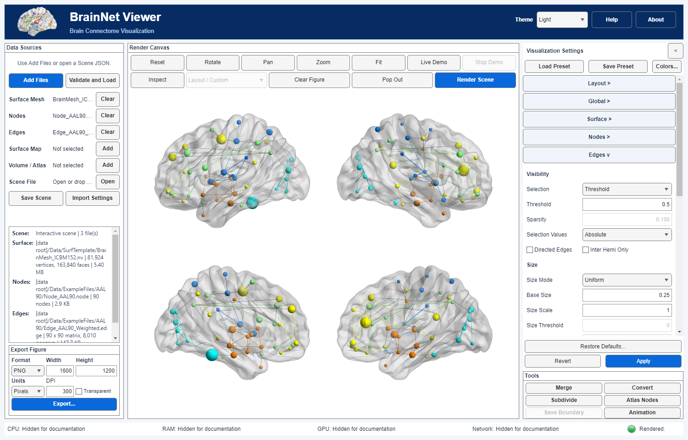

# 03 Networks and edges

[中文](../zh-CN/03_Networks_and_Edges.md) · [Tutorial index](index.md) · [Edge controls](../../manual/en/M08_Edges.md)

Display the bundled AAL90 weighted network in four views. The matrix must use exactly the node table's row order.

## Inputs

Use [ICBM152](../../../../Data/SurfTemplate/BrainMesh_ICBM152.nv), [AAL90 nodes](../../../../Data/ExampleFiles/AtlasNetworks/AAL90.node), and [Edge_AAL90_Weighted.edge](../../../../Data/ExampleFiles/AtlasNetworks/AAL90_Weighted.edge). The example matrix is symmetric and 90 × 90; it is not the eight-node directed teaching network.

## Steps

1. Add surface, nodes and edges in their separate Data Sources rows and load them. Confirm 90 nodes and a 90 × 90 matrix in Scene information.
2. Choose **Lateral / Medial** and gray **Surface Opacity 0.3**.
3. For Nodes choose **Modules**, **Mapped** size and **No Labels**.
4. For Edges choose **Threshold 0.5**, **Selection Values → Absolute**, **Directed Edges off**, **Uniform** size **0.25**, and **Node Module** color.
5. Click **Apply**. The example has 231 undirected pairs at this threshold. Within-module edges inherit module colors; between-module edges use the configured inter-module color.

## Explore the controls

Change threshold and Apply to compare density. A weight threshold is not a P-value test. Mapped size/color can represent weights; document signed versus absolute selection. Sparsity selects a proportion of eligible connections and is not equivalent to a fixed weight cutoff. Restore the exercise values before saving.

Use arrows only when source direction is meaningful; this symmetric example is undirected. Graph lines are not measured white-matter tracts, and Euclidean edge length is not fiber length.

## Export

Set format, pixel/physical dimensions and resolution in Export Figure after rendering. Save a Scene to preserve input order and configuration. Retain [atlas and surface credits](Resource_Attribution.md). The renderer does not infer the biological meaning or statistical significance of the supplied weights.
