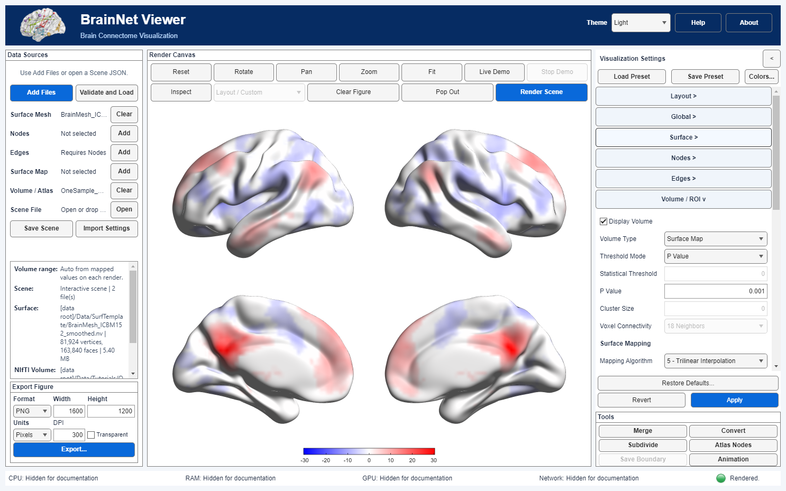

# 05 · Real statistical volume to surface

[中文](../zh-CN/05_Volume_to_Surface_Mapping.md) · [Tutorial index](index.md) · [Volume manual](../../manual/en/M09_Volume_Mapping.md)

This lesson uses a real, one-sample functional-connectivity T map in standard MNI space. The map comes from a PCC-subregion seed analysis in Xia et al. (2014), *Journal of Alzheimer's Disease* **39**:527–543. It is **not** the paper's Alzheimer's-versus-control group contrast. Read the [exact-file provenance and interpretation note](Resource_Attribution.md) before reuse.   

Use [`BrainMesh_ICBM152_smoothed.nv`](../../../../Data/SurfTemplate/BrainMesh_ICBM152_smoothed.nv) as **Surface Mesh** and [`OneSample_ROI11_NC.nii`](../../../../Data/Tutorials/OneSample_ROI11_NC.nii) as **Volume / Atlas**. The NIfTI SHA-256 is `e27d9eca7e20f31ed090e410fdb5b4a409565c2fafc3bc86dff21277e58aad5f`; its header contains `REST{T_[37.0]}`. The matched example yielded 61 × 73 × 61 voxels, 3 mm spacing and T degrees of freedom 37. The surface's source is credited to Prof. Alan C. Evans (MNI); that source credit is distinct from the study citation.

| Control | Exercise value | Why |
|---|---|---|
| Layout → Preset | Lateral / Medial (4 views) | Compare both hemispheres from lateral and medial sides. |
| Surface → Opacity / Show Surface Colorbar | 1 / on (new default) | Keep the anatomical background opaque and display the continuous mapped-T scale. |
| Volume → Display Volume / Volume Type | on / Surface Map | Sample the selected NIfTI onto the mesh. |
| Volume → Threshold Mode / P Value | P Value / `0.001` | Two-sided, **uncorrected voxelwise** threshold inferred from the REST T(37) header. |
| Volume → Mapping Algorithm | 5 · Trilinear Interpolation | Smooth spatial sampling within the volume; unlike algorithm 2, it does not average across adjacent surface vertices. |
| Volume → Display Values / Colormap | Positive & Negative / Blue-White-Red | Show the signs separately; colors encode sampled T values, not P values. |

## Steps

### Step 01

From the project root launch `app = BrainNetViewer;`. In **Data Sources → Add Files**, choose the smoothed ICBM152 `.nv` as **Surface Mesh**, then the `.nii` as **Volume / Atlas**. Click **Validate and Load**. Confirm that Scene Summary lists both project data-root files. Loading alone does not prove alignment: mapping uses the NIfTI affine but does not register images. Verify the affine alignment of these standard-MNI teaching inputs before anatomical interpretation.

### Step 02

Open **Visualization Settings → Layout** and select **Lateral / Medial** (four views). In **Surface**, use **Opacity → 1**. In **Volume / ROI**, enable **Display Volume**, select **Surface Map**, **P Value** and enter `0.001`; set **Mapping Algorithm → 5 - Trilinear Interpolation**, **Display Values → Positive & Negative**, **Colormap → Blue-White-Red** and retain **Adjust for Null**. Click the single shared **Apply** button to commit and render. The R2025a parser converts the two-sided P to approximately `|T| ≥ 3.5737` using df=37; there is no FWE/FDR correction. Algorithm 5 interpolates the already-thresholded volume, so values at edges can be attenuated or blend with zero/background; a displayed vertex is not itself a voxelwise P-value test. Algorithm 2 instead averages each nearest-voxel sample with neighboring surface vertices and can blur across mesh-connected anatomy. Use algorithm 1 when exact voxel statistic sampling is required.

*Current-build English four-view full-window capture. Documentation privacy mode hides local paths on screen. Source volume: Xia et al. (2014), exact NIfTI; source surface: Prof. Alan C. Evans (MNI). Red and blue denote the signs of interpolated T statistics, not disease-group differences.*

*960 × 720 four-view render. Trilinear interpolation follows voxelwise thresholding; visible smoothness is a display property and does not change the nominal voxelwise P cutoff or provide multiple-comparison correction.*

### Step 03

Use **Save Scene** to write a new `.scene.json`, then reopen it in a fresh App session and click **Validate and Load**/**Render Scene**. A focused fresh-App replay restored the four-view preset, algorithm 5 and `P Value = 0.001`, rendered, exported PNG and recorded the two input references in the export provenance. Scene JSON references the files; it does not embed the 2.17 MB NIfTI. Transfer both exact files with the Scene, and inspect JSON/PNG sidecars for personal paths before sharing.

## Errors and interpretation

- If **P Value** rejects a file, check its NIfTI statistic description/intent and degrees of freedom. A filename or value range is not sufficient: the historical `zFCS.nii`, for example, has conflicting description and cannot be used for P conversion as-is.
- A pale or absent patch does not mean a scientifically absent effect. Thresholding, surface sampling, white/null color and the symmetric signed color axis all affect visibility.
- Trilinear interpolation samples the thresholded volume between voxels; it can attenuate edge values and introduce nonzero interpolated values where the nearest voxel itself was below cutoff. Algorithm 2 averages samples over mesh neighbors instead. Displayed vertices are **not** separate corrected significance tests. Switch to algorithm 1 for exact nearest-voxel T samples.
- A plausible render does not independently validate anatomical registration or the original statistical analysis. Confirm source coordinate conventions and analysis-specific inference before publishing.
