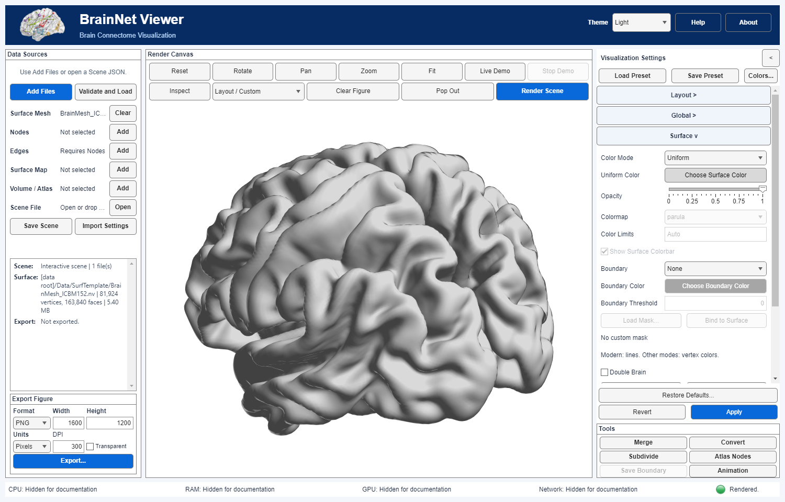
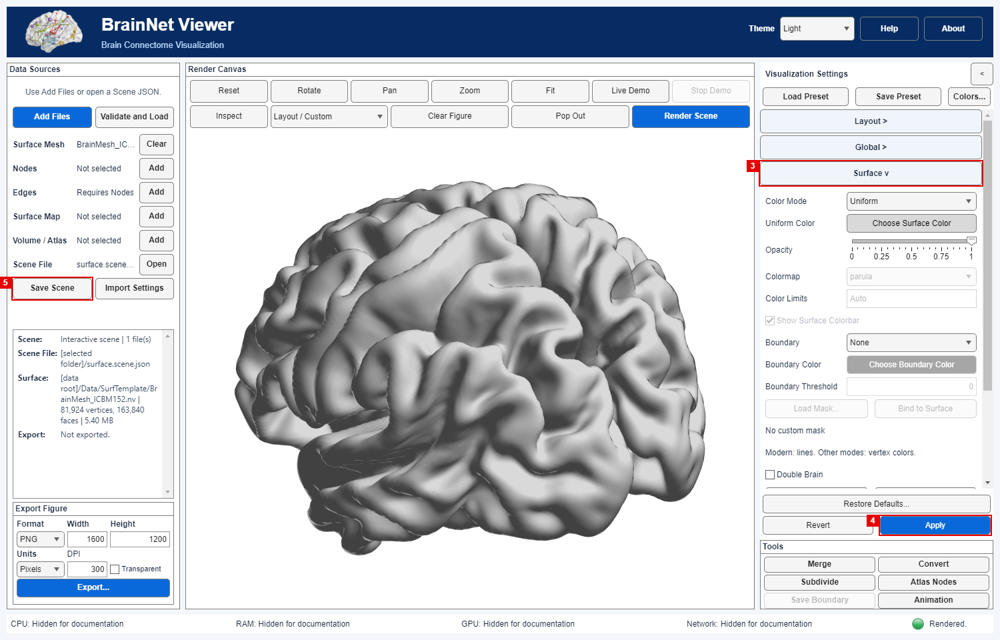

# 01 · 曲面颜色、透明度与视角

[English](../en/01_Surface_Basics.md) · [教程目录](index.md) · [曲面控件](../../manual/zh-CN/M06_Surface.md) · [相机控件](../../manual/zh-CN/M04_Layout_Camera.md)

本教程介绍修改ICBM152曲面的统一颜色与透明度、调整画面，再保存并重新打开Scene。

## 共用输入与参数

与[教程00](00_First_Launch.md)使用**同一份**[`BrainMesh_ICBM152.nv`](../../../../Data/SurfTemplate/BrainMesh_ICBM152.nv)，SHA-256为`471e43f955a1cb9f0350aaca2822f02fc74e393718d1e385fddaf0e578ffe572`。它有81,924顶点、163,840三角面，已位于App数据根目录。见[提供者、坐标和权利说明](Resource_Attribution.md)。使用与教程00相同的Windows/R2025a Update 1内部构建；时间和内存尚未实测。

| 控件 | 练习设置 | 预期作用 |
|---|---|---|
| **Layout Preset** | Single View | 单一相机画面 |
| **View Direction** | Isometric | 三维观察角度，不构成配准验证 |
| **Color Mode** | Uniform | 整个网格使用单色 |
| **Uniform Color** | 选择明显的灰色 | 仅改外观；记录颜色选择器返回的RGB以便重复 |
| **Opacity** | 1 | 不透明，不改变几何或数据 |

## 操作步骤

### Step 01

在项目根目录运行`app = BrainNetViewer;`。在 **Data Sources → Add Files** 中把`Data/SurfTemplate/BrainMesh_ICBM152.nv`选为 **Surface**；这个根目录内的文件正常不提示受控导入。点击 **Validate and Load**。预期：读取一个81,924顶点曲面，没有节点、连边、映射或体数据。

### Step 02

在 **Visualization Settings → Layout** 选择 **Single View** 与 **View Direction → Isometric**。在 **Surface** 保持 **Color Mode → Uniform**，点击 **Uniform Color / Choose Surface Color**，选一个明显的灰色，并记录选择器返回的RGB值；不要假设各机器默认灰色完全一致。把 **Opacity** 设为 **1**。点击统一的 **Apply**，它会提交设置**并渲染**。预期：灰色不透明脑曲面，而不是顶点映射图。

*当前构建完整窗体截图，右侧展开Surface设置；曲面由Prof. Alan C. Evans（MNI）提供。*

### Step 03

点击画布 **Fit** 调整构图；也可试用 **Rotate** 后再次 **Fit**。这些操作改变相机，不修改坐标或曲面原始数据。真实脑模板的视角方向有显示意义，但本教程不独立核验其配准。若之后更改 **View Direction**，保存前还需点击 **Apply** 提交。

### Step 04

点击 **Save Scene**，新建`surface-basics.scene.json`。它记录输入引用/哈希及**已提交**的设置，并可能保留有效的主画布相机；**不**嵌入`.nv`文件。须保持同一数据根目录下的模板文件可用。此处不能用 **Save Preset** 代替，因为预设不含输入路径和当前相机。

### Step 05

用 **Open Scene JSON** 打开刚保存的Scene，点击 **Validate and Load**，再点 **Render Scene**。预期为同一网格及已提交的Uniform/1设置；若内容签名相容，应恢复已保存相机。若签名改变或模板文件缺失，应处理警告/错误，不应宣称视图完全相同。若需要新构图再点 **Fit**。当前Scene渲染完成后才从 **Export Figure** 导出新的PNG；分享前检查相邻的`.provenance.json`。

*Scene重放截图；界面中的文件夹别名仅改变显示，不改变Scene的输入引用。*

## 核对、错例与待补图像

- 核对真实脑曲面、81,924顶点、163,840三角面，新颜色及透明度可见。不要跨渲染器比对RGB像素，也不要把图像当作配准验证。
- **Scalar Map** 需要相容的顶点映射数据，单改Color Mode不会生成数据；本练习使用 **Uniform**。
- 模板`.nv`缺失或哈希变化时，Scene重放应停止，不可静默换用其他网格；若相机因兼容性被重置，须如实记录，而不是宣称逐像素相同。
- 保存Scene JSON时保留所引用的真实模板；重新打开Scene后核对显示设置。
