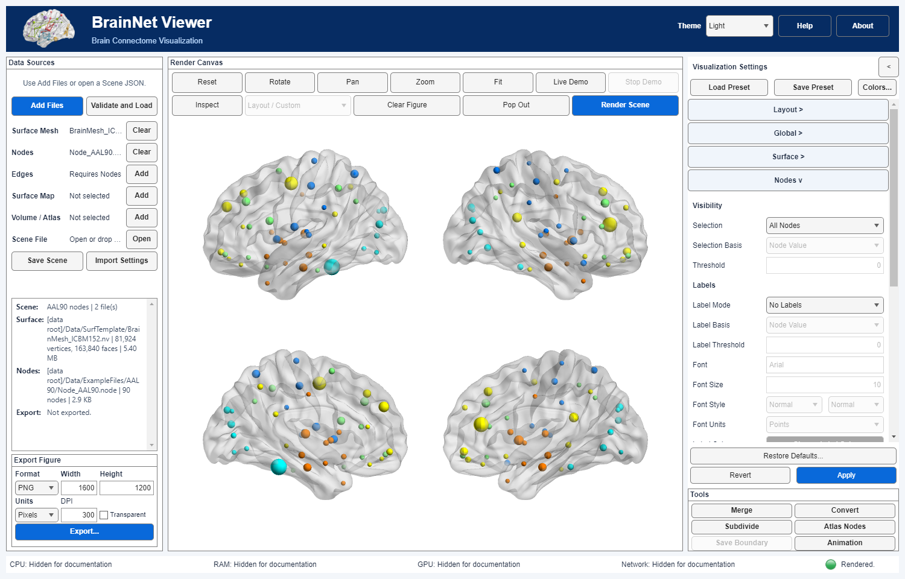

# 02 节点和标签

[English](../en/02_Nodes_and_Labels.md) · [教程索引](index.md) · [节点设置](../../manual/zh-CN/M07_Nodes.md)

使用原配套 AAL90 节点表，在 ICBM152 曲面上以四脑视图展示，不再使用自制八节点教学网络。

## 输入

使用 [BrainMesh_ICBM152.nv](../../../../Data/SurfTemplate/BrainMesh_ICBM152.nv) 和 [Node_AAL90.node](../../../../Data/ExampleFiles/AtlasNetworks/AAL90.node)，后者有90行。每行是 `X Y Z module value label`：第1–3列为坐标，第4列提供模块/颜色编号，第5列提供映射大小的数值，第6列为脑区标签。第4、5列相互独立；这些模块编号不自动等于Yeo网络，显示节点也不证明空间配准。

## 步骤

1. 在 **Surface Mesh → Add** 和 **Nodes → Add** 分别选择输入，点击 **Validate and Load**，保留原坐标及行顺序。
2. Layout选择 **Lateral / Medial**，得到同一Scene的四个视角。
3. Surface选择灰色 **Uniform**，**Opacity 0.3**，显示内部区域节点。
4. Nodes选择 **All Nodes**、**Mapped** 大小、**Node Value** 大小来源及 **Modules** 颜色。第4列决定颜色，第5列决定大小；模块颜色编辑器可调整配色而不改编号。
5. 先选 **No Labels**，点击 **Apply**。

## 标签与筛选

可试用All Labels、适当字号及Keep Labels in Front。密集标签可能重叠，应增加输出尺寸或筛选标签，而不是改变图谱坐标。Node Value按第5列筛选，模块方式按第4列筛选。设阈值后Apply，检查筛选依据，再恢复All Nodes。

## 保存与复用

Scene保留输入引用及已应用设置，preset只保留外观。复用前解决缺失文件、哈希变化及矩阵规模错误。参见[资源署名](Resource_Attribution.md)；节点数值与模块配色本身不证明统计显著性。
